# Discrete-Event Simulation Model: Contact Center Simulator

## 1. Purpose, Scope, and Conventions

This document defines the domain model for a discrete-event simulation of a contact
center. It describes what the simulated contact center contains, how its parts behave,
what inputs drive it, and what it measures. It is the shared vocabulary and reference
for the Spec-Kit specifications that follow, and for judging whether the simulator’s
behavior is correct.

The model is abstract. It describes the contact center as the simulation sees it, not
how the simulator is built.

### 1.1. In Scope

- **Inbound Voice Calls** - This model covers only inbound voice calls.
- **Entities** - The actors and objects in the simulated contact center (Callers,
  Calls, Agents, Queues, the Contact Center), their attributes, their states, and the
  relationships between them.
- **Events** - The things that happen in the contact center and change the state of
  one or more entities.
- **Behaviors** - The rules that determine how entities respond to events, including
  routing, queueing, blocking, and abandonment.
- **Parameters** - The inputs that make up a Scenario: the time frame, Call Volume,
  probability distributions, Queue settings, and Agent schedules.
- **Metrics** - The outputs the simulation reports, and what each one means.
- **Assumptions** - Simplifications the model makes, and the boundaries of the MVP
  (minimum viable product).

### 1.2. Out of Scope

- **Other Channels** - Communication channels such as email, messaging, or outbound
  calls are out of scope.
- **Implementation** - Data structures, storage, how values are represented, which side
  of a relationship “owns” it, and how metrics are computed from simulation output (data
  collection, aggregation, algorithms). What each metric means — which Calls or time
  periods it counts, and its numerator and denominator — is in scope (Section 7).
- **Simulation engine mechanics** - Event scheduling, the simulation clock, random
  number generation, seeding, and variance-reduction techniques such as common random
  numbers.
- **Interfaces** - UI, CLI, APIs, and input/output file formats.
- **The staffing planner** - Using simulation results to recommend staffing levels or
  schedules. That belongs to a separate downstream specification.
- **Spec-Kit artifacts** - Feature specs, plans, and tasks. Those are derived from this
  document but are not part of it.

### 1.3. Scope Guidance

When it’s unclear whether a detail belongs in this document, ask: *Does it change what
the simulated contact center does, or what a metric means?*

- If yes, it belongs here. Examples: whether an Agent can be offered a second Call while
  the first is ringing; whether a Caller can release a Call while it is ringing.
- If it only changes how the simulator stores, represents, or computes something, it
  belongs in the design. Examples: how an unbounded queue capacity is encoded; how the
  Agent-Queue membership is kept consistent in memory.

Relationships are described from the point of view of each entity involved. For example,
an Agent knows the Queues he has joined, and a Queue knows the Agents that have joined
it. Both describe the same relationship.

### 1.4. Conventions

When a term (word or phrase) refers to a concept defined in this model, the term is
capitalized. For example, a “Queue” is an object that is explicitly defined by the
model, whereas a “queue” is to be understood in a general sense.

The table below describes the other conventions used in this document.

| Kind | Notation | Examples |
|---|---|---|
| Entity | Capitalized, regular face | Caller, Call, Agent, Queue, Contact Center |
| Other defined term | Capitalized, regular face | Wait Time, Occupancy, Scenario |
| Attribute or Scenario parameter | camelCase, lowercase first letter, italic | *activityState*, *arrivalTimestamp*, *patience* |
| Qualified attribute | Entity name, a period, then the attribute | Call.*state*, Agent.*activityState* |
| State or *disposition* value | Capitalized, italic, spaces allowed | *Alerting*, *Not Ready*, *Logged In*, *Abandoned* |
| Event | Capitalized, with spaces, regular face, in the form Actor (past tense) Verb Object | Agent Answered Call, CC Blocked Call |
| Duration | Defined term ending in *Time* | Talk Time, Handle Time |
| Timestamp | Attribute name ending in *Timestamp* | *answerTimestamp*, *wrapUpEndTimestamp* |

Notes on the table:

- Attribute names are conceptual names for the model’s properties. They are not
  necessarily the field names an implementation uses (see 1.2), although a name that
  maps to its field name mechanically, such as *activityState* to a field named
  activityState or activity_state, is encouraged.
- An Entity’s attribute and a Scenario parameter that sets it share one name. For
  example, a Queue’s *capacity* is both a Queue attribute and a Scenario parameter.
- A plural attribute name, such as *queues*, *calls*, or *agents*, holds a collection.
  A singular name that matches an Entity, such as *caller*, *queue*, or *agent* on a
  Call, refers to one Entity of that kind.
- Write the qualified form only when a bare name could be ambiguous. For example,
  *identity* and *state* appear on several Entities.
- Attribute names are written in camelCase, and a hyphenated defined term loses its
  hyphen. For example, *wrapUpEndTimestamp* belongs to Wrap-up, and
  *wrapUpTimeDistribution* sets Wrap-up Time.
- A State or *disposition* value is italic when it names the value itself, as in “the
  Agent is *Ready*” or “set *disposition* to *Abandoned*”. The defined terms Abandoned
  Call and Blocked Call are regular face.
- Italics also mark the first use of a term and rare emphasis. The camelCase form tells
  an attribute apart from these.
- In Event names, CC abbreviates Contact Center. No other Actor is abbreviated.

Defined terms distinguish durations from points in time:

- A term ending in *Time* is a duration. Examples: Talk Time, Wait Time, Handle Time,
  and Wrap-up Time. This follows standard contact center usage.
- An attribute name ending in *Timestamp* is a point in Simulation Time. Examples:
  *arrivalTimestamp* and *answerTimestamp*. In prose, the plural “timestamps” refers to
  these attributes in general.

This rule applies only to defined terms. The word “time” in ordinary phrases, such as
“over time” or “at any time”, keeps its everyday meaning. Standard industry names that
do not follow the pattern, such as ASA (Average Speed of Answer), are kept as they are.

## 2. Glossary

(one or two sentences per term, with a pointer to the owning section)

This section defines the terms that are fundamental to the domain model. By explicitly
identifying these terms, we can use them consistently, not only in this domain document,
but also in other documents and in code. This section provides short definitions and
serves as a quick reference. Other sections provide more complete descriptions of the
terms.

### 2.1. Contact Center Domain Terms

Concepts:

- **Contact Center** - A software component that receives Calls and connects them to
  Agents. See 3.1.2.
- **Caller** - A person who places a Call to the Contact Center. See 3.1.1.
- **Call** - A Caller’s attempt to establish a voice session with an Agent. A Call
  starts when the Contact Center receives it and ends when the Caller releases it. If an
  Agent answers, the Call becomes a voice session between the Caller and the Agent.
  Otherwise it ends *Abandoned* or *Blocked*. See 3.2.1.
- **Agent** - A person who answers and handles Calls. See 3.1.3.
- **Queue** - A software component that implements a queue where Calls wait for an
  available Agent. See 3.2.2.
- **Join / Leave (a Queue)** - The operations by which an Agent starts or stops taking
  Calls from a Queue.
- **Routing** - The act of the Contact Center selecting an available Agent for a Call
  and alerting that Agent.
- **Alerting** - The period after a Call is routed to an Agent and before the Agent
  answers it (for example, the Agent’s phone is ringing). The Call and the Agent are
  both *Alerting* during this period.
- **Wait Time** - The time a Caller waits for an Agent. For an answered Call, it’s
  measured from *arrivalTimestamp* to *answerTimestamp*. For an Abandoned Call, it’s
  measured from *arrivalTimestamp* to *releaseTimestamp*.
- **Alert Time** - The time a Call spends *Alerting*, measured from *alertTimestamp* to
  *answerTimestamp*. An *Alerting* Call has been routed and has an assigned Agent, so
  Alert Time is a measurable quantity for both Calls and Agents.
- **Talk Time** - The time an Agent spends connected to a Call, measured from
  *answerTimestamp* to *releaseTimestamp*.
- **Wrap-up** - The work an Agent does after a Call is released and before taking
  another Call, such as entering notes. Also called after-call work (ACW) elsewhere in
  the industry.
- **Wrap-up Time** - The time an Agent spends in Wrap-up for one Call, measured from
  *releaseTimestamp* to *wrapUpEndTimestamp*.
- **Handle Time** - The total Agent time a Call consumes, equal to Talk Time plus Wrap-up Time.
- **Disposition** - The final outcome of a Call: *Completed*, *Abandoned*, or *Blocked*.
- **Abandoned Call** - A Call the Caller releases while it is waiting in a Queue. (Note: A
  Caller cannot release a Call while it is *Alerting*, so every Abandoned Call is
  released from the Queue.)
- **Blocked Call** - A Call the Contact Center rejects on arrival, typically because the
  destination Queue is full.
- **Policy** - A configurable rule set that governs Contact Center behavior. The
  Queueing Policy covers routing, blocking, and Queue capacity. The Staffing Policy
  covers how many Agents are working, and when. See 5.3.
- **Interval** - A fixed period, commonly 15 or 30 minutes, over which input parameters
  are held constant and metrics are reported. (Note: Each Call belongs to exactly one
  Interval: the one containing its *arrivalTimestamp* (see 7.1).)

Metrics:

- **Call Volume** - The number of Calls the Contact Center receives in an Interval. (see
  6.2).
- **AHT (Average Handle Time)** - The mean Handle Time of the answered Calls that
  belong to an Interval.
- **ASA (Average Speed of Answer)** - The mean Wait Time of the answered Calls that
  belong to an Interval.
- **Service Level (SL)** - The percentage of Calls answered within the *Service Level
  Threshold*, a duration such as 20 seconds. Which Calls are counted, and how Abandoned
  and Blocked Calls are treated, is defined in 7.2. A goal such as “80% within 20
  seconds” is a Service Level Target. A target is compared with the metric; it is not
  the metric itself, and it is not part of the Scenario (see 6.7).
- **Abandonment Rate** - The fraction of non-Blocked Calls that end *Abandoned*.
- **Block Rate** - The fraction of received Calls that end *Blocked*.
- **Queue Length** - The number of Calls waiting in a Queue at a given moment. Per
  Interval it is summarized as a time-weighted average and a maximum (see 7.3). Only
  *Queued* Calls count: a Call leaves the Queue when it is routed, so an *Alerting* Call
  is not part of Queue Length.
- **Occupancy** - The fraction of an Agent’s available time spent on Calls. The
  numerator is time in *Alerting*, *Busy*, and *Wrap-up*. The denominator is time in
  *Ready*, *Alerting*, *Busy*, and *Wrap-up*. *Not Ready* time is excluded. *Alerting*
  counts as time spent on Calls because an Alerting Agent cannot take another Call.
  (Some ACDs report ringing time as available time, so their Occupancy can be slightly
  lower than this model’s.)
- **Utilization** - The fraction of an Agent’s logged-in time spent on Calls. The
  numerator is the same as for Occupancy. Unlike Occupancy, the denominator includes
  *Not Ready* and *Inactive* time. The industry uses these two terms inconsistently, so
  this document uses these definitions.

### 2.2. Simulation Terms

- **Entity** - Any Actor or Object in the model (Section 3). Note that simulation
  literature often uses “entity” narrowly, for the items that flow through the system
  (here, Calls). This document uses it in the broader sense.
- **Actor** - An Entity that initiates Events: a Caller, an Agent, or the Contact
  Center.
- **Object** - An Entity that is acted on but does not initiate Events: a Call or a
  Queue.
- **Attribute** - A named property of an Entity, such as a Caller’s *patience* or a
  Call’s *arrivalTimestamp*.
- **State** - The value of an Entity’s *state* Attribute at a point in time. Examples
  are an Agent’s *activityState* and a Call’s *state*.
- **Event** - A point-in-time occurrence that changes the State of one or more
  Entities. Events are listed in Section 4.
- **Transition** - A change from one State to another, triggered by an Event and
  sometimes subject to a condition. Transitions are specified in Section 5.
- **Distribution** - A probability distribution from which the simulation samples
  random values, such as a Caller’s *patience*. Distributions are specified in
  Section 6.
- **Simulation Time** - The model’s clock: the timeline on which all timestamps, such
  as *arrivalTimestamp*, are recorded. It is not wall-clock time. Simulation Time is
  neither a duration nor a timestamp, so it is an exception to the naming rule in 2.4.
- **Scenario** - A complete set of Parameter values that apply to each Replication in an Ensemble.
   “Complete” means the model has no hidden defaults: everything that
  affects what the simulated contact center does is set in the Scenario. Two
  Replications of the same Scenario differ only in their random values. The Scenario’s Parameter
  values are listed in Section 6.
  Note: In design of experiments this is called a *design point*; elsewhere it is often called a *configuration*. This document uses only Scenario.
- **Parameter** - A value set by the Scenario. A value belongs in the Scenario if it can
  differ between Scenarios and changes what happens in a Replication. A rule the model
  fixes, such as FIFO Call selection (5.3.1), is not a parameter: it cannot vary, so it
  is not a hidden default. A value that changes only how Replications are run or how
  results are measured, such as the number of Replications or the Service Level
  Threshold, is not a parameter either (see 6.7). An Attribute differs from a
  parameter: it is a property of an Entity, which may be set from a parameter (for
  example, a Queue’s *capacity*) or may change during a Replication (for example, an
  Agent’s *activityState*).
- **Replication** - One independent execution of the model for a given Scenario. Because
  inputs are random, each Replication produces different results. Metrics are
  computed for each Replication and then summarized across Replications; Calls are
  not pooled across Replications.
- **Ensemble** - A set of Replications of one Scenario, each with a different random
  seed. An Ensemble is the unit over which per-Replication metrics are summarized (mean,
  standard deviation, confidence interval; see 7.3). The term is borrowed from weather
  and climate modeling, where it means the same: runs of one configuration that differ
  only in their random values.
- **Experiment** - A set of Ensembles, one per Scenario, run together for comparison.
  For example, 38 to 46 Agents in steps of 2. This is the sense used in design of
  experiments. Note: How randomness is shared across Scenarios is a design concern (see
  1.2).
- **Event History** - The record of one Replication: every Event that occurred, its
  timestamp, and the Entities it involved. The simulation produces it from a Scenario
  and the execution settings (6.7), and it is the simulation’s only output. Every Metric
  is computed from the Event History and the Scenario, and nothing else (Section 7).

## 3. Simulation Framework

### 3.1. Concepts

The main purpose of the simulator is to generate realistic statistical information about
the performance of a Contact Center. To achieve this goal, the simulator executes
repeated simulation "runs", which we call *Replications*, and we take statistical
measurements across Replications. Simply stated, the simulator implements Monte Carlo
methods.

The diagram below depicts basic execution concepts in the simulation framework.
*Parameters* (section 8) are the configuration settings that control the behavior of the
simulation. A *Scenario* aggregates all the Parameter values needed to control a single
Replication. An *Ensemble* aggregates all the Replications that share the same Scenario.
An *Experiment* aggregates one or more Ensembles, allowing a user to compare different
Scenarios.

During a Replication, the simulator generates and records a number of Events, which it
records in an *Event History*. Processing components (separate from the simulator) can
use the Event History to generate statistical summary information (section 9).

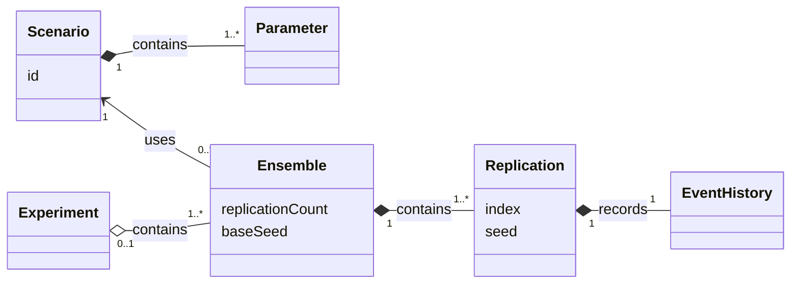

Formal definitions are below:

- **Simulation Time** - The simulation’s clock. Event timestamps in the Event History
  are taken from Simulation Time, as are all timestamps (such as *arrivalTimestamp*). It
  is not wall-clock time. Simulation Time is neither a duration nor a timestamp, so it
  is an exception to the naming rule in 1.4.
- **Scenario** - A complete set of Parameter values that apply to each Replication in an
   Ensemble. “Complete” means the model has no hidden defaults: everything that affects
  what the simulated contact center does is set in the Scenario. Two Replications of the
  same Scenario differ only in their random values. The Scenario’s Parameter values are
  listed in Section 8. Note: In design of experiments this is called a *design point*;
  elsewhere it is often called a *configuration*. This document uses only the term
  Scenario.
- **Parameter** - A value set by the Scenario. A value belongs in the Scenario if it can
  differ between Scenarios and changes what happens in a Replication. A rule the model
  fixes, such as FIFO Call selection ([ref needed]), is not a parameter: it cannot vary, so it
  is not a hidden default. A value that changes only how Replications are run or how
  results are measured, such as the number of Replications or the Service Level
  Threshold, is not a parameter either (see [ref needed]). An Attribute differs from a
  parameter: it is a property of an Entity, which may be set from a parameter (for
  example, a Queue’s *capacity*) or may change during a Replication (for example, an
  Agent’s *activityState*).
- **Replication** - One independent execution of the model for a given Scenario. Because
  the simulation is driven by pseudorandom numbers, each Replication has a different
  seed and produces different results.
- **Ensemble** - A set of Replications of one Scenario, each with a different random
  seed. An Ensemble is the unit over which per-Replication metrics are summarized (see
  7.3). The term is borrowed from weather and climate modeling, where it means the same:
  runs of one configuration that differ only in their random values.
- **Experiment** - A set of Ensembles, one per Scenario, run together for comparison.
  For example, 38 to 46 Agents in steps of 2. This is the sense used in design of
  experiments. Note: How randomness is shared across Scenarios is a design concern (see
  1.2).
- **Event History** - The output record of one Replication: every Event that occurred, its
  timestamp, and the Entities it involved. The simulation produces it from a Scenario
  and the execution settings (6.7), and it is the simulation’s only output. Every Metric
  is computed from the Event History, the Scenario, and the measurement settings.

Remarks:

- A Scenario is identified by an *id*, which may carry a version when Scenarios are kept
  under version control. Many Ensembles can use the same Scenario; each Ensemble has
  exactly one.
- An Ensemble may be run on its own, outside any Experiment. An Experiment has one or
  more Ensembles, each with its own Scenario.
- A Replication belongs to exactly one Ensemble and is identified by its index within
  it. Each Replication has its own Event History and Measurements. An Ensemble
  has one Ensemble Summary, summarized from its Replications’ values. The
  processing that produces them is in 2.3.2.

### 3.2. Processing

The simulation takes a Scenario and the execution settings, and produces an Event
History for each Replication. Two later steps turn the Event History into Metrics.
Measurement settings enter only at the second step, so changing one, such as the Service
Level Threshold, means repeating only the later steps, not the simulation (6.7).

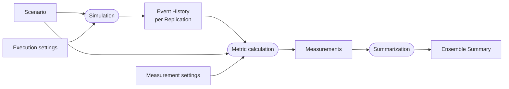

- The rounded boxes are processing steps and the rectangles are data. The steps are
  part of the model; how they are packaged into components is a design concern (see
  1.2).
- Because the Event History is kept, a user can define a new Metric afterward and
  compute it without running the simulation again (Section 7).

## 4. Events

Being based on a discrete-event simulation model, the simulator is driven by *Events*,
which occur at specific instants in time. As the simulator progresses through a
simulation, it advances its clock in *Simulation Time*, which is distinct from “wall
clock time.” The time instant that marks the occurrence of each Event is specified in
Simulation Time.

Events are the basis for all Metrics. Every Event is recorded in the Event History with
its timestamp, its Actor, its Object (if any), and any other relevant information. All
Metrics are defined in such a way that they can be obtained from the Event History (see
Section 9). This rule also imposes a requirement on this Event catalog: Every State
change that a Metric could depend on must be caused by an Event, because a State change
with no Event cannot be measured. When a new behavior is added to the model, any new
State change requires a new Event. A Metric that cannot be computed from the existing
Events indicates that the catalog is incomplete.

| Event | Description | Remarks |
|---|---|---|
| **CC Received Call** | The Contact Center received a new incoming Call. | Every Call begins with this Event. |
| **CC Queued Call** | The Contact Center added the Call to a Queue. | When the Contact Center receives a new Call, if there is no Agent available to take the Call, the Contact Center adds the Call to its destination Queue, provided the Queue has not reached its *capabity*. |
| **CC Routed Call** | The Contact Center selected an available Agent to handle the Call. | When an Agent is available to handle a Call and a Call is available for routing, the Contact Center routes the Call to the Agent. This event occurs in to situations: (1) the Contact Center receives a new Call an Agent is available, (2) there is a Call in the Queue when an Agent becomes available. |
| **CC Blocked Call** | The Contact Center blocked a new incoming Call. | When the Contact Center receives a new incoming Call, it may block the Call. In the real world, a Contact Center can block a Call for various reasons. In this simulation, the Contact Center blocks a Call only if the destination Queue is full and there is no Agent available to handle the Call (see 6.1).  In this simulation, the Contact Center blocks the Call by applying a treatment, such as an announcement or busy signal, to the Caller. Upon receiving treatment, the Caller release the Call. |
| **Agent Logged In** | An Agent logged in to start his work shift. | Every Agent starts his work shift by logging in. After logging in, the Agent must join a Queue and become *Ready* before he can handle Calls. Various Agent-related metrics may be measured against the Agent's full work shift. |
| **Agent Joined Queue** | An Agent joined a Queue. | When an Agent joins a Queue, the Agent becomes listed on the Queue's roster, which contains all the Agents who may handle that Queue's Calls. After logging in, an Agent typilcally joins one or more Queues. Even when joined to a Queue, the Agent must enter the *Ready* state before he is available to handle Calls. |
| **Agent Answered Call** | An Agent answered a Call. | An Agent answers a Call. This Event marks the beginning of a (voice) conversation between the Agent and the Caller. |
| **Caller Released Call** | A Caller released a Call. | This Event ends the Call from the Caller's perspective. If an Agent handled the Call, the Agent continues to engage with the Call to complete Wrap-Up. |
| **Agent Completed Wrap-Up** | An Agent completed the wrap-up activity. | After the Caller releases the Call, the Agent completes Wrap-Up activity. This Event marks the end of Wrap-Up. |
| **Agent Requested Not Ready** | An Agent requested to become *Not Ready* | If an Agent is in *Alerting*, *Busy*, or in *Wrap-up* state, he cannot immediately become *Not Ready*. After this Event occurs, the Agent moves to *Not Ready* instead of *Ready* at the next available opportunity. This Event may occur, for example, when an Agent's break is scheduled to begin and the Agent is currently handling a Call. |
| **Agent Became Not Ready** | An Agent became *Not Ready*. | An Agent became *Not Ready* and is unavailable to handle a Call. In a real-world contact center, an Agent may become *Not Ready* so that he can take a break, attend training, or otherwise disengage from handling Calls. The Agent remains joined to one or more Queues while in the *Not Ready* state. |
| **Agent Became Ready** | An Agent made himself available to handle Calls. | An Agent became *Ready* and is available to handle a Call. This Event occurs, for example, after an Agent's break ends. The Agent must be joined to a Queue before he can become *Ready*. |
| **Agent Left Queue** | An Agent left (unjoined) a Queue. |  After this Event, the Agent is no longer on the roster to handle Calls for that Queue. See also Note 2 below. |
| **Shift Ended** | An Agent’s scheduled work shift ended | This Event marks the end of an Agent's *scheduled* shift, but not necessarily his *actual* shift, due to over time. See Note 3 below. When an Agent's scheduled shift ends, the Agent follows an end-of-shift procedure that involves completing any current Call handling activity, leaving all joined Queues, and logging out. See section 6.2. |
| **Agent Logged Out** | An Agent logged out. | The Agent logged out and his actual shift ended. |

**Notes**

1. This Event can happen immediately after CC Received Call if an Agent is available to
   handle the Call. Alternatively, if the Call is in a Queue, the Event immediately
   after an Agent becomes available. In either case, the Call has an associated
   destination Queue. When a Call is routed, it is removed from the Queue’s *calls* and
   does not remain in the Queue while *Alerting* (see 3.2.2).

2. When the shift ends (Agent Ended Shift), the Agent leaves all Queues when the
   Staffing Policy releases them (5.3.2). Agent Left Queue takes effect immediately in
   any *activityState*; it stops new Calls from that Queue but does not affect a Call
   the Agent is already handling (see 3.1.3).

3. There is no Shift Started Event to correspond with the Shift Ended Event. An Agent's
   shift starts when the Agent first logs in, as recorded by the Agent Logged In Event,
   and ends when the Agent logs out, as recorded by the Agent Logged Out Event. Also,
   the Shift Ended Event marks the end of an Agent's scheduled shift, but not
   necessarily his actual shift, due to overtime. If the Agent is not handling a Call,
   his shift may end immediately. However, if he *is* handling a Call, he must complete
   the handling before his shift may end. Additionally, if the shift end corresponds
   with the end of the Day, the Agent must continue the handle Calls until the Queue is
   empty. 
   

## 5. Entities

Entities model real-world "things" that participate in a Contact Center. This domain model
separates Entities into Actors (Entities that can initiate actions) and Objects (Entities that
are the object of actions).

Every Entity has a unique identity, which is recorded in log messages and Event History.

### 5.1. Actors

#### 5.1.1. Caller

A *Caller* is a person who makes a Call. In this domain model, a Caller makes exactly
one Call to the Contact Center.

A Caller’s behavior is controlled by one Attribute, *patience*, which is sampled from
the *patienceDistribution* of the Call’s destination Queue (see 5.2.2 and 8.3). The
*patience* attribute determines how long the Caller will wait before releasing a Queued
Call.

In this model, a Call ends only when its Caller releases it, which may happen in three
different situations. First, when the Contact Center blocks the Call, it provides a
treatment (such as an announcement or busy signal) to the Caller, causing the Caller to
release the Call. Second, when the Call remains in its Queue too long, as determined by
the Caller’s *patience* attribute, the Caller releases the Call before it’s routed.
Lastly, if the Call is answered, the Caller releases the Call after talking with the
Agent at the end of the Talk Time. In this model, a Caller cannot release an Alerting
Call.

**Attributes**

- *identity* - A unique identifier for the Caller. This value may be recorded in log
  messages or simulation output.
- *patience* - How long the Caller will wait in the Queue before releasing the Call. It
  is measured from the *arrivalTimestamp* (see 3.2.1). *patience* can be unlimited,
  meaning the Caller never abandons the Call.

**Notes**

- *patience* matters only for a queued Call. The Caller releases a *Queued* Call
  (Caller Released Call, *disposition* *Abandoned*) when *patience* has elapsed after the
  *arrivalTimestamp*, unless the Call is routed first. A Call that is routed or
  Blocked on arrival never uses *patience*, so the model sets it only when the Call is
  queued (see 5.2). Sampling a value for every Call instead, for example to keep random
  numbers aligned across Scenarios, is a design choice (see 1.2); it does not change the
  model’s behavior.
- A Caller cannot release an *Alerting* Call. This is mainly a simplifying assumption.
  We assume that while the Call is *Alerting*, the Caller hears ringback, announcement, or other
  treatment that indicates (to the Caller) that his Call will be answered shortly.

#### 5.1.2. Contact Center

A Contact Center is a software application that receives Calls and connects them to
Agents. When a new Call arrives and an Agent is available, the Contact Center
immediately routes the Call (to an available Agent). When no Agent is available, the
Contact Center adds the Call to the destination Queue to wait for an Agent. When an
Agent becomes available, the Contact Center routes the Call to that Agent. The Contact
Center may manage multiple Queues, each according to its Queueing Policy (Section 6).

In this model, there is only one Contact Center.

**Attributes**

- *queues* - The Queues managed by the Contact Center.
- *agents* - The complete list of Agents that are in the simulation.

**Notes**:

- In the MVP, there is only one Contact Center and one Queue.
- The Contact Center maintains a complete list of Agents, including Agents that have not
  logged in or joined a Queue.

#### 5.1.3. Agent

##### 5.1.3.1. Overview

An Agent handles Calls. To handle a Call, an Agent answers the Call and remains on the
Call until the Caller releases it. After the Caller releases the Call, the Agent
completes Wrap-up before becoming available to handle another Call.

An Agent conducts all his activity in a work shift, which has a scheduled start and a scheduled end. The actual shift starts at the scheduled start time and ends at the scheduled end time, provided the Agent is not needed for overtime activities (see Section 6.2). At the start of his actual shift, the Agent logs in; at the end, he logs out.

An Agent *joins* one or more Queues. When an Agent joins a Queue, he can handle Calls received for that Queue. An Agent may *leave* (unjoin) a Queue.

An Agent has state and attributes.

##### 5.1.3.2. Attributes and State

**Attributes**

- *identity* - A unique identifier for the Agent. This identifier can appear in log
  messages or simulation output. It may be used to generate per-Agent metrics.
- *queues* - The list of Queues the Agent has joined.
- *sessionState* - A dynamic state attribute that tracks an Agent’s work availability. (See values below.)
- *activityState* - A dynamic state attribute that tracks an Agent’s work activity. (See values below.)
- *notReadyPending* - The Agent has requested to become *Not Ready*. When this Boolean
  attribute is “true”, the next *activityState* transition that would otherwise go to
  *Ready* will instead go to *Not Ready*. In the MVP, the only reason an Agent becomes
  *Not Ready* is a scheduled break (5.3.2).
- *logoutPending* - The Agent’s scheduled shift has ended, but the Agent has not yet left their
  Queues and logged out, because they are still on a Call or because Calls are still
  waiting at closing. When this Boolean attribute is “true”, the Staffing Policy
  releases the Agent as soon as the rules in 5.3.2 allow: the Agent leaves their Queues
  and logs out. It is “false” until the Agent’s shift ends.

**State**

Session State:

- *Logged In* - The Agent can join a Queue and handle Calls.
- *Logged Out* - The Agent is not joined to any Queues, cannot join any Queues, and
  cannot handle Calls.

Activity State:

- *Inactive* - The Agent has not joined any Queue and is not handling a Call.
- *Ready* - The Agent is currently ready to handle a Call.
- *Alerting* - The Contact Center has routed a Call to the Agent, but the Agent has not
  yet answered.
- *Busy* - The Agent is currently handling a Call.
- *Wrap-up* - The Agent is performing wrap-up activity. In this state, the
  Agent is unable to handle a new Call.
- *Not Ready* - The Agent is not ready to handle a Call (for example, on a
  break).

**Notes**:

- In the MVP, an Agent can join only one Queue.
- An Agent must leave all Queues before he can log out.
- An Agent handles at most one Call at a time. The Contact Center routes a Call only to
  an Agent whose *activityState* is *Ready* and who has joined the Call’s Queue. Such an
  Agent is called an available Agent. An Agent who is *Alerting*, *Busy*, in
  *Wrap-up*, or *Not Ready* is not offered another Call.
- The *Alerting* state tracks the *Alerting* state of the Call. During this time, the
  Contact Center can provide to the Agent a whisper message or information about the
  Caller.
- An Agent must complete in-progress Call-related activity before he can become *Not
  Ready*. If the Agent is in *Alerting*, *Busy*, or *Wrap-up*, he can request to become
  *Not Ready* after *Wrap-up*. This request changes the Agent’s *notReadyPending*
  attribute to “true”. After the Agent completes Wrap-up, his state changes to *Not
  Ready* instead of *Ready*.
- When an Agent’s shift ends (Agent Ended Shift), *logoutPending* is set. The Agent
  leaves all Queues and logs out as soon as the Staffing Policy releases him (5.3.2).
  That is normally at once, or at the end of Wrap-up if the Agent is *Alerting*,
  *Busy*, or in *Wrap-up*, so the Agent can work past the end of the shift. An Agent
  whose shift ends at closing stays joined, even on a break, while Calls are still
  waiting.
- An Agent can leave a Queue at any time. Leaving removes the Agent from the Queue’s
  roster, so the Contact Center routes no more Calls from that Queue to the Agent. It
  does not affect a Call the Agent is already handling: that Call stays with the Agent
  (the Call’s *agent* attribute) through answer, Talk Time, and Wrap-up.
- If an Agent leaves his last Queue while in *Alerting*, *Busy*, or in *Wrap-up*, his
  *activityState* does not change. When he completes Wrap-up, he goes to *Inactive*
  instead of *Ready* or *Not Ready*.

##### 5.1.3.3. Agent State Transitions

The *activityState* applies only while the Agent’s *sessionState* is *Logged In*, so
it is shown nested inside *Logged In*. Transition labels are Events from Section 4,
except “(on completion)”, which marks a completion transition (see Notes). Labels in
square brackets are conditions.

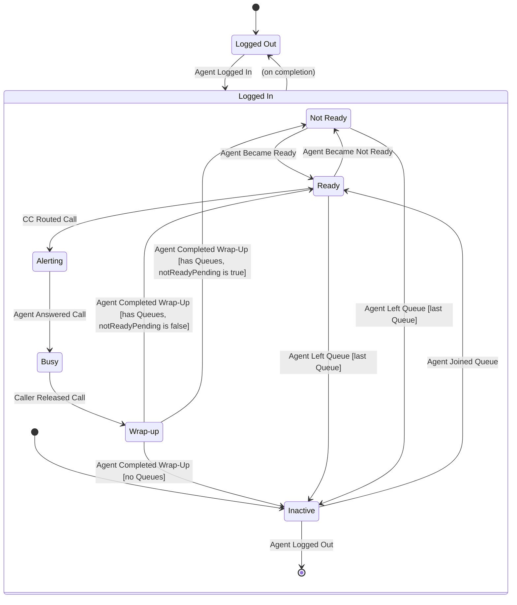

Session State Transitions:

| Current State | Event | Condition(s) | Next State |
|---|---|---|---|
| *Logged Out* | Agent Logged In | | *Logged In* |
| *Logged In* | Agent Logged Out | *activityState* is *Inactive*; *logoutPending* is “true” | *Logged Out* |

Activity State Transitions (apply only while *sessionState* is *Logged In*):

| Current State | Event | Condition(s) | Actions | Next State |
|---|---|---|---|---|
| — (entering *Logged In*) | Agent Logged In | | | *Inactive* |
| *Inactive* | Agent Joined Queue | | Add Agent to Queue’s *agents* / Add Queue to Agent’s *queues* | *Ready* |
| *Ready* | CC Routed Call | | | *Alerting* |
| *Alerting* | Agent Requested Not Ready | | Set *notReadyPending* to “true” | *Alerting* |
| *Alerting* | Agent Left Queue | | Remove Agent from Queue’s *agents* / Remove Queue from Agent’s *queues* | *Alerting* |
| *Alerting* | Agent Answered Call | | | *Busy* |
| *Busy* | Agent Requested Not Ready | | Set *notReadyPending* to “true” | *Busy* |
| *Busy* | Agent Left Queue | | Remove Agent from Queue’s *agents* / Remove Queue from Agent’s *queues* | *Busy* |
| *Busy* | Caller Released Call | | | *Wrap-up* |
| *Wrap-up* | Agent Requested Not Ready | | Set *notReadyPending* to “true” | *Wrap-up* |
| *Wrap-up* | Agent Left Queue | | Remove Agent from Queue’s *agents* / Remove Queue from Agent’s *queues* | *Wrap-up* |
| *Wrap-up* | Agent Completed Wrap-Up | *queues* is empty | Set *notReadyPending* to “false” | *Inactive* |
| *Wrap-up* | Agent Completed Wrap-Up | *queues* is not empty; *notReadyPending* is “false” | | *Ready* |
| *Wrap-up* | Agent Completed Wrap-Up | *queues* is not empty; *notReadyPending* is “true” | Set *notReadyPending* to “false” | *Not Ready* |
| *Ready* | Agent Became Not Ready | | | *Not Ready* |
| *Not Ready* | Agent Became Ready | | | *Ready* |
| *Ready* | Agent Left Queue | last Queue | Remove Agent from Queue’s *agents* / Remove Queue from Agent’s *queues* | *Inactive* |
| *Ready* | Agent Left Queue | not last Queue | Remove Agent from Queue’s *agents* / Remove Queue from Agent’s *queues* | *Ready* |
| *Not Ready* | Agent Left Queue | last Queue | Remove Agent from Queue’s *agents* / Remove Queue from Agent’s *queues* | *Inactive* |
| *Not Ready* | Agent Left Queue | not last Queue | Remove Agent from Queue’s *agents* / Remove Queue from Agent’s *queues* | *Not Ready* |
| *Inactive* | Agent Logged Out | *logoutPending* is “true” | | — (leaving *Logged In*) |
| *Ready* | Agent Ended Shift | | Set *logoutPending* to “true” / Set *notReadyPending* to “false” | *Ready* |
| *Not Ready* | Agent Ended Shift | | Set *logoutPending* to “true” / Set *notReadyPending* to “false” | *Not Ready* |
| *Alerting* | Agent Ended Shift | | Set *logoutPending* to “true” / Set *notReadyPending* to “false” | *Alerting* |
| *Busy* | Agent Ended Shift | | Set *logoutPending* to “true” / Set *notReadyPending* to “false” | *Busy* |
| *Wrap-up* | Agent Ended Shift | | Set *logoutPending* to “true” / Set *notReadyPending* to “false” | *Wrap-up* |
| *Ready* | Agent Left Queue | *logoutPending* is “true”; release rule met (5.3.2) | Remove Agent from Queue’s *agents* / Remove Queue from Agent’s *queues* | *Inactive* |

**Notes**:

- Agent Left Queue can happen in any *activityState* except *Inactive*. While *Alerting*,
  *Busy*, or in *Wrap-up*, it only removes the Agent from the Queue’s roster; the Agent finishes
  the Call and goes to *Inactive* at the end of Wrap-up if no Queues remain (see 3.1.3).
  The diagram omits these self-transitions and the Agent Requested Not Ready
  self-transitions; the table lists them.
- Agent Ended Shift does not change *activityState*. The Staffing Policy then releases
  the Agent (5.3.2) with Agent Left Queue for each of the Agent’s Queues, followed by
  Agent Logged Out once the Agent is *Inactive*. An Agent who was *Ready* or *Not Ready*
  goes to *Inactive* and logs out at the same instant. An Agent who is *Alerting*,
  *Busy*, or in *Wrap-up* goes to *Inactive* at the end of Wrap-up, because no Queues
  remain, and then logs out. The exception is an Agent whose shift ends at closing, who
  stays joined until the Queue is empty, and who finishes any break in progress (Not
  *Ready* → *Inactive* happens when the Queue empties, or the Agent goes to *Ready* at the
  end of the break if Calls are waiting). The table lists the Agent Ended Shift rows; the diagram
  omits them.
- The Agent can log out only from *Inactive*. In the diagram, Agent Logged Out moves the
  Agent to the final state of *Logged In*; the edge labeled “(on completion)” from
  *Logged In* to *Logged Out* is a completion transition that fires when that final
  state is reached. It is not a second way to log out. The Session State table states
  the same rule directly, as a condition on Agent Logged Out.
- The rows marked “—” in the Activity State table are where the two tables meet:
  logging in starts the *activityState* at *Inactive*, and logging out ends it.

##### 5.1.3.4. Measured Times

The timeline below shows one Agent over about 13 minutes: the Agent joins a Queue,
handles two Calls, requests Not Ready during the 2nd Call, takes a break, and then
becomes Ready again. Each lane shows the time spent in one *activityState*. The
lower three lanes show the time that feeds Occupancy and Utilization (see 2.1).

```mermaid
---
config:
  gantt:
    displayMode: compact
    leftPadding: 170
  themeVariables:
    sectionBkgColor: "#c9d6f0"
    altSectionBkgColor: "#ffffff"
    sectionBkgColor2: "#c9d6f0"
  themeCSS: ".section0, .section1, .section2, .section3 { opacity: 0.35; }"
---
gantt
    title Agent activity: measured times (example)
    dateFormat HH:mm:ss
    axisFormat %M:%S
    tickInterval 1minute

    section Inactive
    Inactive            :i1, 00:00:00, 00:00:30

    section Ready
    Ready               :r1, 00:00:30, 00:01:30
    Ready               :r2, 00:05:45, 00:06:15
    Ready               :r3, 00:12:30, 00:13:20

    section Alerting (Alert Time)
    1st Call            :active, a1, 00:01:30, 00:01:45
    2nd Call            :active, a2, 00:06:15, 00:06:30

    section Busy (Talk Time)
    1st Call            :active, b1, 00:01:45, 00:04:45
    2nd Call            :active, b2, 00:06:30, 00:08:30

    section Wrap-up (Wrap-up Time)
    1st Call            :active, w1, 00:04:45, 00:05:45
    2nd Call            :active, w2, 00:08:30, 00:09:30

    section Not Ready
    Not Ready           :n1, 00:09:30, 00:12:30

    section On Calls
    On Calls            :crit, o1, 00:01:30, 00:05:45
    On Calls            :crit, o2, 00:06:15, 00:09:30

    section Available
    Available           :done, v1, 00:00:30, 00:09:30
    Available           :done, v2, 00:12:30, 00:13:20

    section Logged In
    Logged In           :done, l1, 00:00:00, 00:13:20
```

- *On Calls* is time in *Alerting*, *Busy*, and *Wrap-up*: 4:15 + 3:15 = 7:30.
- *Available* adds *Ready* time to *On Calls*: 7:30 + 2:20 = 9:50.
- *Logged In* adds *Not Ready* and *Inactive* time: 9:50 + 3:00 + 0:30 = 13:20.
- Occupancy = 7:30 / 9:50 = 76%. Utilization = 7:30 / 13:20 = 56%.

### 5.2. Objects

#### 5.2.1. Call

##### 5.2.1.1. Overview

A Call represents a Caller’s attempt to talk to an Agent. A Caller places only one Call
and may talk to only one Agent. The Call succeeds when the Caller actually talks to an
Agent (see note 1). The attempt may also fail, such that the Caller does not talk to an
Agent (details below). In the former case, the Call has an associated Agent; in the
latter, it does not.

Every Call has a destination Queue. The Queue is where the Call waits, if necessary, for
an Agent (see note 2). The Queue also defines the roster of Agents who may answer the Call.

Calls are the basis for many key performance statistics, such as Average Speed of Answer
(mean Wait Time) and Abandonment Rate. To facilitate these statistical measurements,
every Call records relevant timestamps and a disposition, which provide the raw data.
The disposition records the final outcome of the Call, which can be one of these:
- "Blocked" - the Contact Center refused the Call (for example, the destination Queue
  was full)
- "Abandoned" - the Caller released the Call while waiting for an Agent
- "Completed" - an Agent answered (and handled) the Call

The Contact Center moves a Call through a succession of processing stages, which are
tracked via the Call's *state*. The state's values and the transitions between them are
modeled as a finite state machine (FSM). This FSM models the way a Contact Center
manager thinks about the Call processing. (While it may be useful in the simulator's
design, it is primarily a modeling construct.)

Notes:
1. In this model, a Call succeeds when an Agent answers it. Whether the Agent resolves
   the Caller’s problem is outside the model’s scope.
2. If an Agent is immediately available, the Contact Center routes the Call to that
   Agent without adding it to the destination Queue. Such a Call is never *Queued* and
   does not count toward the Queue’s *capacity*.

##### 5.2.1.2. Attributes and State

**Attributes**

- *identity* - A unique identifier for the Call. This identifier can appear in log
  messages or simulation output.
- *caller* - The Caller who placed the Call.
- *queue* - The Call’s destination Queue.
- *agent* - The Agent who answered the Call, if any.
- *state* - The state of the Call. (See below.)
- *arrivalTimestamp* - When the Contact Center received the Call. The model assumes
  the Contact Center instantly processes new incoming Calls. Therefore, if the Call is
  queued, the *arrivalTimestamp* is also when the Call entered the Queue.
- *alertTimestamp* - When the Contact Center routed the Call to an Agent.
- *answerTimestamp* - When the Agent answered the Call.
- *releaseTimestamp* - When the Caller released the Call.
- *wrapUpEndTimestamp* - When the Agent completed Wrap-up for this Call.
- *disposition* - The final outcome of the Call: *Completed* / *Abandoned* / *Blocked*.

**State**

The Call's *state* can assume one of the following values:

- *Initial* - This is the initial state of a new Call.
- *Queued* - The Contact Center added the Call to the destination Queue.
- *Alerting* - The Contact Center routed the Call to an Agent. The Agent has not yet answered the Call.
- *Connected* - The Agent has answered the Call.
- *Released* - The Caller has released the Call.
- *Blocked* - The Contact Center blocked the Call.

**Notes**:

- This model assumes the Caller always releases the Call.
  - Rationale: This assumption allows us to define a single event to end a call, which
    follows a consistent naming convention of `actor action [direct object]`.
- The Call’s *state* ends at *Released*, but for a *Completed* Call, its record is
  complete only when the *wrapUpEndTimestamp* is set.
- When the Contact Center blocks a Call, it provides a treatment (*e.g.*, an
  announcement or busy tone) to the Caller, who then releases the Call. We consider the
  time between the Contact Center blocking the Call and the Caller releasing the call to
  be out of scope for metrics; therefore, we intentionally model the treatment time to
  be zero (see 5.2).

##### 5.2.1.3. State Transitions

Transition labels are Events from Section 4. Labels in square brackets are conditions,
and labels in parentheses are the *disposition* the path sets.

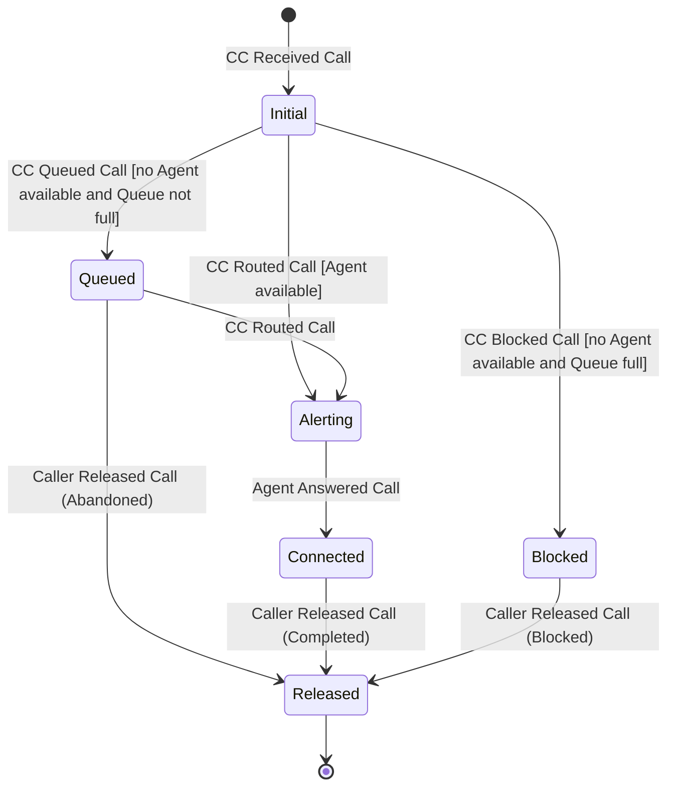

Call State Transitions:

| Current State | Event | Condition(s) | Actions | Next State |
|---|---|---|---|---|
| — (new Call) | CC Received Call | | Set *arrivalTimestamp* / Set *queue* to the destination Queue | *Initial* |
| *Initial* | CC Routed Call | an available Agent has joined the Call’s *queue* | Set *agent* / Set *alertTimestamp* | *Alerting* |
| *Initial* | CC Queued Call | no available Agent; Queue is not full | Add Call to Queue’s *calls* / Set Caller’s *patience* | *Queued* |
| *Initial* | CC Blocked Call | no available Agent; Queue is full | | *Blocked* |
| *Queued* | CC Routed Call | | Remove Call from Queue’s *calls* / Set *agent* / Set *alertTimestamp* | *Alerting* |
| *Queued* | Caller Released Call | | Remove Call from Queue’s *calls* / Set *releaseTimestamp* / Set *disposition* to *Abandoned* | *Released* |
| *Alerting* | Agent Answered Call | | Set *answerTimestamp* | *Connected* |
| *Connected* | Caller Released Call | | Set *releaseTimestamp* / Set *disposition* to *Completed* | *Released* |
| *Blocked* | Caller Released Call | | Set *releaseTimestamp* / Set *disposition* to *Blocked* | *Released* |
| *Released* | Agent Completed Wrap-Up | *disposition* is *Completed* | Set *wrapUpEndTimestamp* | *Released* |

**Notes**:

- The Call’s *disposition* is set by the path into the final state. Released from
  *Queued* is *Abandoned*, from *Connected* is *Completed*, and from *Blocked* is
  *Blocked*. The table sets it on entering *Released*, so every Call that has ended has
  exactly one *disposition*, and a Call that has not ended has none.
- The table lists only Events that change the Call’s *state* or its record. What each
  Event does to the Agent is in 5.1; Agent Answered Call, Caller Released Call, and
  Agent Completed Wrap-Up appear in both tables.
- When timed Events occur is set by the sampled durations: Agent Answered Call when
  Alert Time has elapsed after the *alertTimestamp*, Caller Released Call from
  *Connected* when Talk Time has elapsed after the *answerTimestamp*, and Agent
  Completed Wrap-Up when Wrap-up Time has elapsed after the *releaseTimestamp* (see
  3.2.2). Caller Released Call from *Queued* occurs when the Caller’s *patience* has
  elapsed after the *arrivalTimestamp* (see 3.1.1).
- The last row is a self-transition on the final state. The Call’s *state* no longer
  changes after *Released*, but its record is not complete until the Agent finishes
  Wrap-up (see 3.2.1). The diagram omits this transition.
- *Blocked* lasts zero time: Caller Released Call follows CC Blocked Call immediately,
  so a Blocked Call’s *releaseTimestamp* equals its *arrivalTimestamp*. A real Contact
  Center may play an announcement before disconnecting, but that time does not matter
  here. A Blocked Call does not occupy the Queue or an Agent, and every metric counts it
  by its *arrivalTimestamp*, so a non-zero time would change no result (see Section 8).
- *Initial* lasts zero time, because the model assumes the Contact Center processes
  new Calls instantly (see *arrivalTimestamp* in 3.2.1).
- There is no *Alerting* to *Released* transition, because a Caller cannot release an
  *Alerting* Call (see 3.1.1).

##### 5.2.1.4. Measurements

Every time measurement of a Call is the difference between two of its timestamps. The
timeline below shows a Completed Call. Note that Wait Time and Alert Time overlap: the
Caller is still waiting while the Agent is being alerted. Handle Time (Talk Time plus
Wrap-up Time) is what AHT averages. Service Time, the queueing-theory term (see 2.2),
also includes Alert Time, because the Agent is occupied from the *alertTimestamp*.

```mermaid
---
config:
  themeVariables:
    sectionBkgColor: "#c9d6f0"
    altSectionBkgColor: "#ffffff"
    sectionBkgColor2: "#c9d6f0"
  themeCSS: ".section0, .section1, .section2, .section3 { opacity: 0.35; }"
---
gantt
    title Completed Call: measured times (example)
    dateFormat HH:mm:ss
    axisFormat %M:%S
    tickInterval 30second

    section Timestamps
    arrival             :milestone, t1, 00:00:00, 0s
    alert               :milestone, t2, 00:00:45, 0s
    answer              :milestone, t3, 00:01:00, 0s
    release             :milestone, t4, 00:04:00, 0s
    wrap-up end         :milestone, t5, 00:05:00, 0s

    section Call state
    Queued              :s1, 00:00:00, 00:00:45
    Alerting            :s2, 00:00:45, 00:01:00
    Connected           :s3, 00:01:00, 00:04:00
    Released            :milestone, s4, 00:04:00, 0s

    section Caller
    Wait Time           :crit, c1, 00:00:00, 00:01:00

    section Agent
    Alert Time          :active, a1, 00:00:45, 00:01:00
    Talk Time           :active, a2, 00:01:00, 00:04:00
    Wrap-up Time        :active, a3, 00:04:00, 00:05:00

    section Derived
    Handle Time         :done, d1, 00:01:00, 00:05:00
    Service Time        :done, d2, 00:00:45, 00:05:00
```

An Abandoned Call has only an *arrivalTimestamp* and a *releaseTimestamp*. Its Wait
Time is the whole time it spent Queued, and it has no Alert Time, Talk Time, or Wrap-up
Time. A Blocked Call has no measured times.

```mermaid
---
config:
  themeVariables:
    sectionBkgColor: "#c9d6f0"
    altSectionBkgColor: "#ffffff"
    sectionBkgColor2: "#c9d6f0"
  themeCSS: ".section0, .section1, .section2, .section3 { opacity: 0.35; }"
---
gantt
    title Abandoned Call: measured times (example)
    dateFormat HH:mm:ss
    axisFormat %M:%S
    tickInterval 15second

    section Timestamps
    arrival             :milestone, t1, 00:00:00, 0s
    release             :milestone, t2, 00:01:10, 0s

    section Call state
    Queued              :s1, 00:00:00, 00:01:10

    section Caller
    Wait Time           :crit, c1, 00:00:00, 00:01:10
```

#### 5.2.2. Queue

A Queue (object) implements a queue where Calls wait for an available Agent.

**Attributes**

Attributes set by the Scenario (see 6.3 and 6.4), which do not change during a
Replication:

- *identity* - A unique identifier for the Queue. This identifier can appear in log
  messages or simulation output. In a multi-Queue scenario, the identifier enables
  per-Queue metrics.
- *capacity* - The maximum number of Calls that can wait in the Queue: a non-negative
  integer or unlimited. Zero and unlimited are needed for validation against queueing
  theory (see 2.2 and 5.3.1).
- *alertTimeDistribution* - The probability distribution from which the Alert Time of
  each Call routed from this Queue is sampled.
- *talkTimeDistribution* - The probability distribution from which the Talk Time of
  each answered Call to this Queue is sampled.
- *wrapUpTimeDistribution* - The probability distribution from which the Wrap-up
  Time of each answered Call to this Queue is sampled.
- *patienceDistribution* - The probability distribution from which the *patience* of
  the Caller of each queued Call to this Queue is sampled (see 3.1.1).

Attributes that change during a Replication:

- *calls* - The Calls waiting in the Queue, in order of arrival. It holds only
  *Queued* Calls.
- *agents* - The roster of Agents who have joined the Queue.

**Notes**:

- A Call leaves the Queue when the Contact Center routes it to an Agent (CC Routed Call),
  not when the Agent answers. An *Alerting* Call is therefore not in the Queue’s *calls*
  and does not count toward *capacity* or Queue Length (see 5.3.1).
- In the MVP, Alert Time, Talk Time, and Wrap-up Time are sampled independently of each
  other, of the Caller’s *patience*, and of the Agent who answers the Call. The model
  must not rule out adding a correlation between Talk Time and Wrap-up Time later (for
  example, a correlation parameter on the Queue).
- The Agent answers an Alerting Call (Agent Answered Call) when its sampled Alert Time
  has elapsed after the *alertTimestamp*.
- The Caller releases a Connected Call (Caller Released Call) when its sampled Talk Time
  has elapsed after the *answerTimestamp*. Caller Released Call is the Event that ends
  the Call.
- The Agent completes Wrap-up (Agent Completed Wrap-Up) when the sampled Wrap-up Time
  has elapsed after the *releaseTimestamp*.

## 6. Policies

(Queueing, Staffing, shift end, closing, and drain)

#### 6.1. Queueing Policy

The Queueing Policy decides what happens to a Call on arrival, which Agent gets a Call,
and which waiting Call an Agent gets. In the MVP:

- **Queue capacity.** *capacity* counts only Calls waiting in the Queue (*Queued*).
  Calls that are *Alerting* or *Connected* do not count. The Queue is full when the
  number of Calls in its *calls* equals its *capacity*.
  - A *capacity* of zero means no Call ever waits: each Call is routed or Blocked on
    arrival. This matches Erlang B (2.2).
  - An unlimited *capacity* means no Call is ever Blocked. This matches Erlang C and
    Erlang A (2.2).
- **On arrival.** If an Agent is available, the Contact Center routes the Call (CC
  Routed Call). Otherwise, if the Queue is not full, it queues the Call (CC Queued
  Call). Otherwise, it blocks the Call (CC Blocked Call). A full Queue is the only
  reason a Call is Blocked.
- **Agent selection: longest idle.** When more than one Agent is available for an
  arriving Call, the Contact Center routes it to the Agent who has been *Ready* the
  longest, that is, the Agent whose most recent entry into *Ready* is earliest.
- **Call selection: FIFO.** When an Agent becomes available and Calls are waiting, the
  Contact Center routes the Call that has waited the longest, that is, the Call with the
  earliest *arrivalTimestamp*. An Agent becomes available by entering *Ready* while
  joined to the Queue: by Agent Joined Queue, Agent Became Ready, or Agent Completed
  Wrap-Up.

**Notes**:

- Only one of the two selection rules applies at any moment. Because routing is
  instant, Calls wait only when no Agent is available, and Agents wait in *Ready* only
  when no Calls are waiting.
- Longest idle does not change aggregate metrics when Agents are identical. It does
  change per-Agent metrics (Occupancy, Utilization), because it spreads Calls evenly
  across Agents.

#### 6.2. Staffing Policy

The Staffing Policy decides when each Agent works and is available. In the MVP, it
follows the Agent schedules in the Scenario (6.5). Each Agent has one shift and may have
breaks. The schedule produces these Agent Events:

- At the *shiftStartTimestamp*: Agent Logged In, then Agent Joined Queue.
- When a break becomes due: Agent Became Not Ready if the Agent is *Ready*; otherwise
  Agent Requested Not Ready (see Breaks below).
- When a break ends: Agent Became Ready.
- At the *shiftEndTimestamp*: Agent Ended Shift. When the Agent is released (see Shift
  end below): Agent Left Queue for each Queue the Agent has joined, then Agent Logged
  Out as soon as the Agent is *Inactive*.

**Breaks.** A break has a *scheduledStart*, a *duration*, and an *earlyStartAllowance*
(6.5). It becomes *due* at its *scheduledStart* minus its *earlyStartAllowance*. A
break is a flexible window, not a fixed time slot:

- If the Agent is *Ready* when the break becomes due, the break starts at once. This can
  be up to *earlyStartAllowance* before the *scheduledStart*. With an allowance of zero,
  a *Ready* Agent starts the break at the *scheduledStart*.
- If the Agent is *Alerting*, *Busy*, or in *Wrap-up*, Agent Requested Not Ready sets
  *notReadyPending*, and the break starts when Wrap-up ends, even if Calls are waiting.
  The break can start after the *scheduledStart*. The Agent who is not *Ready* when the
  break becomes due therefore starts it at the first moment they would otherwise become
  *Ready*.
- A break always lasts its full *duration*, measured from when it actually starts. A
  late start does not shorten it, and an early start does not lengthen it. Agent Became
  Ready occurs when the *duration* has elapsed after the start. A break never ends while
  the Agent is in *Wrap-up*, because the Agent is *Not Ready* for the whole break.
- Only one break is pending or in progress at a time. If another break becomes due
  while one is pending or in progress, it waits. When the break in progress ends, a
  waiting break starts at once: the Agent stays *Not Ready*, with no Agent Became Ready
  between the two breaks, so no waiting Call is routed to the Agent.
- A break that is not yet started when the shift ends is not taken.

**Shift end.** Agent Ended Shift occurs at the Agent’s *shiftEndTimestamp*, which is not
later than the *closingTimestamp* (6.5). It sets *logoutPending* to “true” and
*notReadyPending* to “false”, which cancels any pending break. It does not change the
Agent’s *activityState*. The Staffing Policy then *releases* the Agent: Agent Left
Queue for each Queue, then Agent Logged Out once the Agent is *Inactive*. When the Agent
is released depends on when the shift ends:

- **Shift ends before closing.** The Agent is released at Agent Ended Shift if they are
  *Ready* or *Not Ready*. An Agent on a break has the break cut short. An Agent who is
  *Alerting*, *Busy*, or in *Wrap-up* has Agent Left Queue take effect at once (3.1.3);
  they finish the Call, go to *Inactive* at the end of Wrap-up, and log out. Calls may
  still be waiting; the Scenario is responsible for the staffing.
- **Shift ends at closing** (*shiftEndTimestamp* equals the *closingTimestamp*). The
  Agent stays joined to the Queue, so the planned staffing at closing is not reduced,
  and a break in progress runs to its end, so the Agent gets the full break. The Agent
  is released at the first moment, at or after Agent Ended Shift, when the Queue’s
  *calls* is empty and the Agent is not *Alerting*, *Busy*, or in Wrap-up. This is
  checked when:
  - Agent Ended Shift occurs;
  - the Agent’s Wrap-up ends;
  - the Agent’s break ends; and
  - the Queue becomes empty (by CC Routed Call or by a Caller abandoning). An Agent on a
    break is then released at once, and the break is cut short.

  If Calls are waiting at the end of Wrap-up or of a break, the Agent goes to *Ready* and
  is routed the next Call, and the check repeats at the end of that Call’s Wrap-up. After
  closing no Calls arrive, so the Queue only shrinks and every such Agent is eventually
  released.

A *Ready* Agent who is still joined can exist only when the Queue is empty, so a *Ready*
Agent at closing is released at once. The time between Agent Ended Shift and Agent
Logged Out is the Agent’s overtime, and it counts as logged-in time for Utilization.

**Notes**:

- The schedule is the canonical form of staffing. An Agent count per Interval, such as
  an Erlang-based staffing curve, does not say which Agents leave or when, so it is not
  a Scenario parameter. A client, such as the staffing planner, converts a count into
  Agent schedules before it submits the Scenario (see 1.2).
- Breaks are fixed in the Scenario in the MVP. Adjusting them during a Replication is
  deferred (Section 8). A later version could distinguish mandatory breaks from
  discretionary ones.
- An Agent whose shift ends before closing leaves even if Calls are waiting. The
  Scenario is responsible for scheduling enough Agents (see Section 8).

## 7. Event Ordering

(simultaneous and stale Events)

## 8. Parameters

This section lists the parameters that make up a Scenario (2.3). Together they are
complete: nothing else affects what happens in a Replication except the random values.
How a Scenario is encoded or submitted is an interface concern (1.2).

### 8.1. Time Frame

| Parameter | Meaning |
|---|---|
| *startTimestamp* | The date and time of day of Simulation Time zero. It is also the opening time and the start of the first Interval. |
| *intervalLength* | The length of each Interval, such as 15 or 30 minutes. |
| *intervalCount* | The number of Intervals in the open period. |

The *closingTimestamp* is the *startTimestamp* plus *intervalCount* ×
*intervalLength*. No Calls arrive after it. The simulation then continues through the
drain (Section 8), so the end of a Replication is not a parameter.

The *intervalLength* is a parameter, not only a reporting choice, because the arrival
rate is constant within an Interval (6.2). Daylight-saving changes are out of scope for
the MVP: Simulation Time maps to clock time by adding it to the *startTimestamp*.

### 8.2. Demand

| Parameter | Meaning |
|---|---|
| *callVolume* (per Queue) | The expected number of Calls in each Interval: one non-negative value per Interval, *intervalCount* values in all. |

Calls arrive in a Poisson process whose rate is constant within each Interval. For
Interval *i*, the rate is *callVolume*[*i*] / *intervalLength*. The value is an
expected count, so the observed Call Volume (an output, 2.1) varies between
Replications. Expressing input as a count per Interval makes it directly comparable to
the Call Volume that live contact centers report.

The Poisson process is a model rule, not a parameter, because the MVP supports no other
arrival process.

### 8.3. Caller Behavior

| Parameter | Meaning |
|---|---|
| *patienceDistribution* (per Queue) | The distribution from which each queued Caller’s *patience* is sampled (3.1.1). It may be unlimited. |

*patience* is a Caller Attribute, but its distribution belongs to the Queue (3.2.2).
Caller patience usually differs by call type, so this keeps the model ready for
multiple Queues.

### 8.4. Queue

| Parameter | Meaning |
|---|---|
| *identity* | The Queue’s unique identifier. |
| *capacity* | A whole number (zero or more) or unlimited (5.3.1). |
| *alertTimeDistribution* | The distribution of Alert Time. |
| *talkTimeDistribution* | The distribution of Talk Time. |
| *wrapUpTimeDistribution* | The distribution of Wrap-up Time. |

The MVP has one Queue (Section 8). A Talk Time / Wrap-up Time correlation is not in the
MVP, where they are independent (3.2.2).

In the MVP, every distribution in 6.3 and 6.4 is constant for the whole day. Values
that vary by Interval are deferred (Section 8).

### 8.5. Agents

| Parameter | Meaning |
|---|---|
| *identity* | The Agent’s unique identifier. It also sets the order of simultaneous Agent Events (5.4). |
| *queues* | The Queues the Agent joins at login. In the MVP, the one Queue. |
| *shiftStartTimestamp* | When the Agent’s shift starts. |
| *shiftEndTimestamp* | When the Agent’s shift ends. It is later than the *shiftStartTimestamp* and not later than the *closingTimestamp*. A value equal to the *closingTimestamp* means the Agent stays joined until the Queue is empty (5.3.2, Section 8). |
| *breaks* | A list of breaks. The list may be empty. Each break has a *scheduledStart*, a *duration*, and an *earlyStartAllowance* (zero or more; zero means the break never starts early). The *scheduledStart* and *duration* lie within the shift, breaks do not overlap, and *scheduledStart* minus *earlyStartAllowance* is not before the *shiftStartTimestamp*. The Agent may start the break later than *scheduledStart* (5.3.2). |

The Scenario lists every Agent in the Contact Center’s *agents* (3.1.2). The Staffing
Policy turns these values into Agent Events (5.3.2).

### 8.6. Distributions

Each distribution parameter names a family and its values. The MVP supports these
families:

| Family | Values | Allowed for |
|---|---|---|
| Constant | the value (zero or more) | all |
| Exponential | the mean | all |
| Lognormal | the mean and the standard deviation | all |
| Unlimited | none | *patience* only |

Lognormal is described by its mean and standard deviation, not by the parameters of the
underlying normal distribution, so its values can be compared directly with measured
AHT. These families cover the validation runs in Section 8: constant zero for Alert
Time and Wrap-up Time, exponential for Talk Time and *patience*, and unlimited
*patience*. Other families are added only when a need comes up.

### 8.7. Not Part of the Scenario

These values are needed to execute or measure a simulation, but they do not change what
happens in a Replication, so they are not Scenario parameters:

- **Execution settings** - The number of Replications, which belongs to the Ensemble,
  and the random seed (1.2), which belongs to the Replication. Each Replication’s seed
  may be derived from a base seed set on the Ensemble.
- **Measurement settings** - The Service Level Threshold, the Service Level Target,
  and the Intervals used to compare with queueing theory in validation runs
  (Section 8). Metrics are computed from the Scenario and the Event History (Section 7),
  so these can change after a Replication without running it again.
- **Model rules** - Rules with only one option in the MVP: the Poisson arrival process
  (6.2), FIFO Call selection and longest-idle Agent selection (5.3.1), and the order of
  simultaneous Events (5.4). A rule becomes a parameter when a second option is
  supported.

## 9. Metrics

This section defines how the simulator's results are measured. Sections 9.1 and 9.2 explain the concepts, which are independent of any particular Metric. Section 9.3 defines the Baseline Metrics, which make the concepts concrete. Section 9.4 explains how a user adds Custom Metrics.

### 9.1. Concepts

Every Metric is computed from the Scenario, the Event History, and the measurement settings (Section 3), and from nothing else.

| Concept | Definition | Example |
|---|---|---|
| **Duration** | The time between two Events in the Event History, for one Call or one Agent. Not a Metric. | Wait Time of Call 17: CC Received Call to Agent Answered Call |
| **Period** | A window of Simulation Time over which a Metric is measured. It is chosen when results are measured, not in the Scenario. | 3:00–3:30 PM; the Day |
| **Metric** | A named rule that yields a value from one Replication's Event History over a Period (9.2). | ASA |
| **Measurement** | The value of a Metric for one Replication and one Period. May be *undefined*. | ASA = 4.3 minutes for Interval 3 of Replication 5 |
| **Ensemble Summary** | A statistical summary of the Measurements of one Metric and Period across the Replications of an Ensemble. | The spread of Interval 3's ASA across 30 Replications |

The chain is: Event History → Durations and counts → Measurements → Ensemble Summary. The Measurements of one Replication are its *Replication Measurements*.

**How the concepts attach to the framework (Section 3).**

| Framework level | What it yields for each Metric and Period |
|---|---|
| Replication | One Measurement, computed from its Event History |
| Ensemble | One Ensemble Summary, over the Replication Measurements |
| Experiment | Nothing new: one Ensemble Summary per Scenario, so Scenarios can be compared |

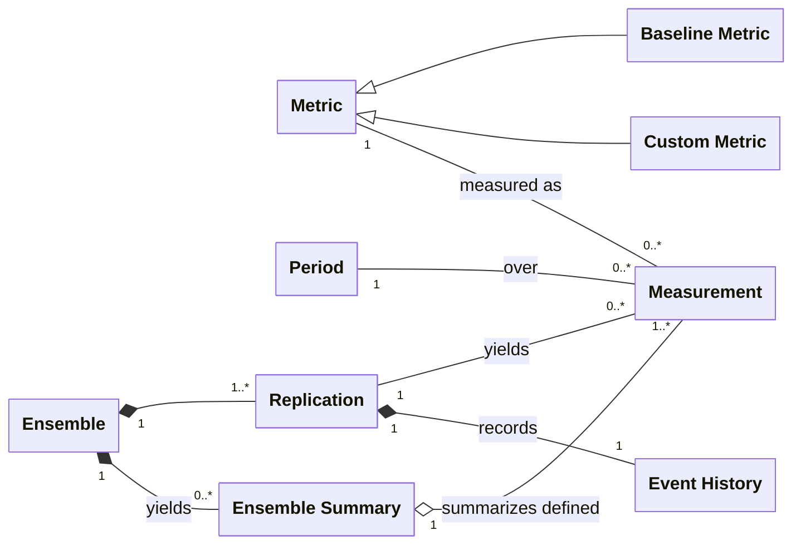

*Figure 9.1. The metrics concepts and how they relate. A Measurement is identified by its Replication, Metric, and Period together. An Ensemble Summary summarizes only the defined Measurements.*

Two constraints are not visible in the diagram:

- There is exactly one Measurement for each combination of Replication, Metric, and Period.
- All the Measurements in an Ensemble Summary share one Ensemble, one Metric, and one Period, and together these identify the Summary.

**Undefined Measurements.** A Measurement is *undefined* when its Metric's denominator is zero (for example, ASA over a Period with no Completed Calls). An undefined Measurement is not zero, and it is not 100%. An Ensemble Summary uses only the defined Measurements and never imputes a value for an undefined one. Which statistics a Summary reports (for example, mean, standard deviation, confidence interval, count of defined Measurements) is a design concern (Section 1), not part of the model.

### 9.2. Periods

A Period (9.1) belongs to measurement, not to the Scenario: choosing one changes no Replication, so it can be changed after the Replication is run (Section 3, Processing).

- The window of each Scenario Interval (Section 8) is a Period. The **Day** is the open period, from *startTimestamp* to *closingTimestamp*.
- Any other window is also a Period, such as a lunch hour or a window that extends past closing.
- A Period carries no tiling guarantee. Periods may overlap or leave gaps. When a user's Periods do tile a larger Period, the counts add up across them, but that is a consequence of the user's choice, not a rule of the model.

Two rules say what falls inside a Period:

- **Calls of a Period** are the Calls whose *arrivalTimestamp* is in the Period, regardless of when they are answered, released, or wrapped up. A single anchor keeps every Call-based Metric describing the same set of Calls, and it is the only rule that covers Abandoned and Blocked Calls, which have no *answerTimestamp*. Consequence: a Measurement is not final until all the Calls of its Period have ended, which may be after the Period ends.
- **Time within a Period** is the part of a span of Simulation Time that overlaps the Period. A span that crosses a Period boundary is clipped, so each Period gets only its own part.

Consequence of the Day definition: work done after *closingTimestamp* (the drain, Section 11) lies outside the Day, so the Day's time-based Measurements exclude it. Calls that arrived before closing but finish during the drain still count in the Day's Call-based Measurements. A user who wants drain-time work in a time-based Measurement can define a Period that extends past closing.

Periods are specified independently of Intervals, but the examples in this section use Intervals as Periods.

#### 9.2.1. Running example

The figures in this section use one small example. The values are made up for illustration.

- *intervalLength* = 15 minutes. Interval *n* = 09:00 to 09:15, Interval *n+1* = 09:15 to 09:30. Each is used as a Period.
- Queue *capacity* = 2.
- *Service Level Threshold* = 3 minutes (illustrative; real thresholds are seconds).
- Two Agents, A and B, both logged in at 09:00. A joins the Queue at 09:00. B joins at 09:04 and starts a 16-minute break at the same instant, so B is *Not Ready* from 09:04 to 09:20.
- Five Calls arrive in Interval *n*:

| Call | Arrival | Path |
|---|---|---|
| 1 | 09:02 | A is *Ready*, so the Call is routed on arrival. Completed. |
| 2 | 09:05 | No Agent is available. Queued until A finishes Wrap-up at 09:08. Completed. |
| 3 | 09:10 | Queued until A finishes Wrap-up at 09:17. Completed. |
| 4 | 09:12 | Queued behind Call 3, abandons at 09:14. Abandoned. |
| 5 | 09:13 | Two Calls are already waiting, so the Queue is full. Blocked. |

```mermaid
gantt
    title Calls arriving in Interval n (09:00-09:15)
    dateFormat HH:mm
    axisFormat %H:%M

    section Periods
    Interval n           :active, in, 09:00, 15m
    Interval n+1         :in1, 09:15, 15m

    section Call 1 (Completed)
    Alerting             :active, c1a, 09:02, 1m
    Talk                 :crit, c1t, 09:03, 4m
    Wrap-up              :c1w, 09:07, 1m

    section Call 2 (Completed)
    Queued               :done, c2q, 09:05, 3m
    Alerting             :active, c2a, 09:08, 1m
    Talk                 :crit, c2t, 09:09, 7m
    Wrap-up              :c2w, 09:16, 1m

    section Call 3 (Completed, ends in n+1)
    Queued               :done, c3q, 09:10, 7m
    Alerting             :active, c3a, 09:17, 1m
    Talk                 :crit, c3t, 09:18, 6m
    Wrap-up              :c3w, 09:24, 2m

    section Call 4 (Abandoned)
    Queued, then abandons :done, c4q, 09:12, 2m

    section Call 5 (Blocked)
    Blocked on arrival   :milestone, c5b, 09:13, 0m
```

*Figure 9.2. The five Calls. Grey is Queued, blue is Alerting, red is Talk, and the default color is Wrap-up. All five Calls belong to Interval n because each arrives in it, so Interval n is not final until Call 3's Wrap-up ends at 09:26.*

### 9.3. Baseline Metrics

A **Baseline Metric** is a Metric the model defines and every simulator must support. A Custom Metric (9.4) is any other Metric. Both are instances of the same concept: a rule that yields a Measurement. The model fixes which Metrics are baseline. Which of them a simulator reports by default is a design concern.

#### 9.3.1. Call-based Baseline Metrics

These Metrics use the Calls of the Period (9.2), grouped by *disposition*. Every answered Call is Completed, so "answered" and "Completed" are interchangeable here. A Day Measurement pools the Day's Calls and is not an average of Interval Measurements.

**Durations used.**

| Duration | From Event | To Event | Applies to |
|---|---|---|---|
| Wait Time | CC Received Call | Agent Answered Call (Completed) or Caller Released Call (Abandoned) | Completed and Abandoned Calls |
| Talk Time | Agent Answered Call | Caller Released Call | Completed Calls |
| Wrap-up Time | Caller Released Call | Agent Completed Wrap-Up | Completed Calls |
| Handle Time | Agent Answered Call | Agent Completed Wrap-Up | Completed Calls (Talk Time plus Wrap-up Time) |

**Metrics.**

| Metric | Definition | Undefined when |
|---|---|---|
| **Call Volume** | Number of Calls | never (zero is a valid count) |
| **AHT** | Mean Handle Time of Completed Calls | no Completed Calls |
| **ASA** | Mean Wait Time of Completed Calls | no Completed Calls |
| **Service Level** | Completed Calls with Wait Time at or below the Service Level Threshold, divided by Completed plus Abandoned Calls | Completed plus Abandoned is zero |
| **Abandonment Rate** | Abandoned Calls divided by Completed plus Abandoned Calls | Completed plus Abandoned is zero |
| **Block Rate** | Blocked Calls divided by Call Volume | Call Volume is zero |

Notes:

- **Service Level.** The threshold is a measurement setting (Section 3). Wait Time runs to *answerTimestamp*, so Alert Time counts against the threshold. Abandoned Calls, including short abandons, count in the denominator and never in the numerator. This is the definition Erlang A predicts (Section 10). Blocked Calls are excluded.
- **Rates.** Service Level and Abandonment Rate share a denominator, and Blocked Calls appear only in Block Rate, so no Call is double-counted.
- **ASA.** It excludes Abandoned Calls. Their Wait Time exists but belongs to no Baseline Metric. A user can define one (9.4).

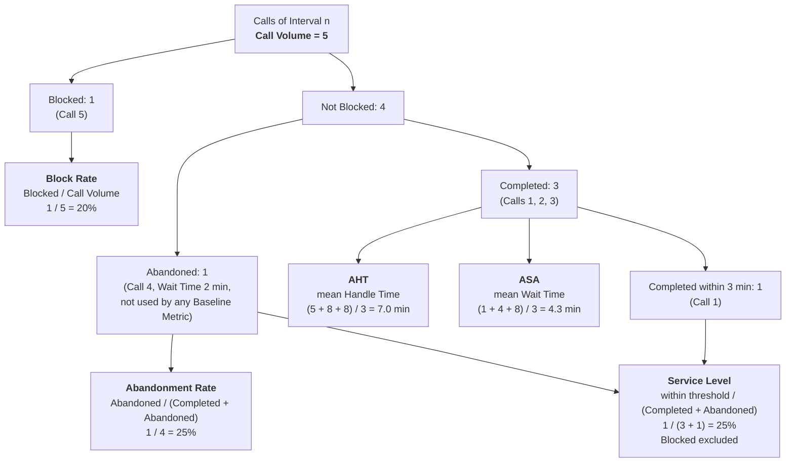

*Figure 9.3. Which Calls feed which Call-based Baseline Metric, for Interval n.*

| Metric | Numerator | Denominator | Calls included |
|---|---|---|---|
| Call Volume | count | not applicable | all |
| Block Rate | Blocked | all | all |
| Abandonment Rate | Abandoned | Completed + Abandoned | all except Blocked |
| AHT | sum of Handle Time | Completed | Completed |
| ASA | sum of Wait Time | Completed | Completed |
| Service Level | Completed within threshold | Completed + Abandoned | all except Blocked |

#### 9.3.2. Time-based Baseline Metrics

These Metrics are based on time, not Calls. Agent time is pooled across all Agents and clipped to the Period (9.2).

**Agent time quantities.** These are Durations summed over a Period, not Metrics.

- **On-Call Time** - time in *Alerting*, *Busy*, or *Wrap-up*.
- **Available Time** - On-Call Time plus time in *Ready*.
- **Logged-In Time** - Available Time plus time in *Not Ready* and *Inactive* while *Logged In*, from Agent Logged In to Agent Logged Out. It includes overtime inside the Period (the time after Agent Ended Shift).

**Metrics.**

| Metric | Definition | Undefined when |
|---|---|---|
| **Occupancy** | On-Call Time divided by Available Time | Available Time is zero |
| **Utilization** | On-Call Time divided by Logged-In Time | Logged-In Time is zero |
| **Average Queue Length** | Time-weighted mean number of *Queued* Calls over the Period | never |
| **Maximum Queue Length** | Largest number of *Queued* Calls at any instant in the Period | never |

Notes:

- *Alerting* counts as On-Call Time because an *Alerting* Agent cannot take another Call. An *Alerting* Call is not *Queued*, so it never counts toward Queue Length.
- The industry uses "Occupancy" and "Utilization" inconsistently. These definitions are the model's own.
- Per-Agent Occupancy and Utilization are deferred (Section 11).

**Clipping.** Agent A's *Busy* time for Call 2 runs from 09:09 to 09:16. The Period boundary at 09:15 splits it: six minutes count toward Interval *n* and one minute toward Interval *n+1*.

```mermaid
gantt
    title Agent activityState over two Periods
    dateFormat HH:mm
    axisFormat %H:%M

    section Periods
    Interval n           :active, in, 09:00, 15m
    Interval n+1         :in1, 09:15, 15m

    section Agent A
    Ready                :done, a1, 09:00, 2m
    Alerting             :active, a2, 09:02, 1m
    Busy (Call 1)        :crit, a3, 09:03, 4m
    Wrap-up              :a4, 09:07, 1m
    Alerting             :active, a5, 09:08, 1m
    Busy (Call 2, in n)  :crit, a6, 09:09, 6m
    Busy (Call 2, in n+1, clipped) :crit, a6b, 09:15, 1m
    Wrap-up              :a7, 09:16, 1m
    Alerting             :active, a8, 09:17, 1m
    Busy (Call 3)        :crit, a9, 09:18, 6m
    Wrap-up              :a10, 09:24, 2m
    Ready                :done, a11, 09:26, 4m

    section Agent B
    Inactive             :b1, 09:00, 4m
    Not Ready (break)    :b2, 09:04, 16m
    Ready                :done, b3, 09:20, 10m
```

*Figure 9.4. Agent time in each activityState. Grey is Ready, blue is Alerting, red is Busy, and the default color is Wrap-up, Not Ready, or Inactive (the label names the state). The Busy time for Call 2 is split at the Period boundary.*

**Minutes in each state, pooled across Agents.**

| State | Interval *n* | Interval *n+1* |
|---|---|---|
| Ready | 2 (A) | 14 (A 4, B 10) |
| Alerting | 2 (A) | 1 (A) |
| Busy | 10 (A) | 7 (A) |
| Wrap-up | 1 (A) | 3 (A) |
| Not Ready | 11 (B) | 5 (B) |
| Inactive | 4 (B) | 0 |
| **Total** | **30** | **30** |

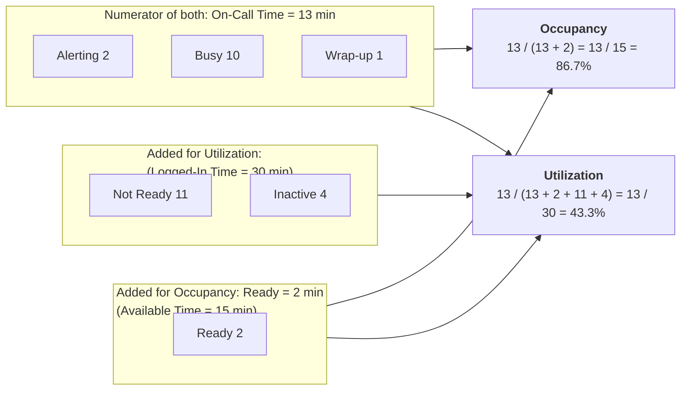

*Figure 9.5. What counts in each denominator, for Interval n, pooled across both Agents.*

| | Interval *n* | Interval *n+1* |
|---|---|---|
| On-Call Time (Alerting + Busy + Wrap-up) | 13 | 11 |
| Available Time (On-Call Time + Ready) | 15 | 25 |
| **Occupancy** | **86.7%** | **44.0%** |
| Logged-In Time (Available Time + Not Ready + Inactive) | 30 | 30 |
| **Utilization** | **43.3%** | **36.7%** |

A Day Measurement pools total time over total time across all Agents and Intervals.

**Queue Length.** Queue Length is the number of *Queued* Calls at an instant. For Interval *n*:

| Time | Queued Calls | Minutes |
|---|---|---|
| 09:00 to 09:05 | 0 | 5 |
| 09:05 to 09:08 | 1 (Call 2) | 3 |
| 09:08 to 09:10 | 0 | 2 |
| 09:10 to 09:12 | 1 (Call 3) | 2 |
| 09:12 to 09:14 | 2 (Calls 3, 4) | 2 |
| 09:14 to 09:15 | 1 (Call 3) | 1 |

- **Average Queue Length** = (0·5 + 1·3 + 0·2 + 1·2 + 2·2 + 1·1) / 15 = 10 / 15 ≈ **0.67**
- **Maximum Queue Length** = **2**

### 9.4. Custom Metrics

A user may define a Metric other than the Baseline Metrics, such as:

- a different Service Level Threshold;
- a Service Level that excludes short abandons or counts Blocked Calls;
- a Wait Time statistic over Abandoned Calls;
- a Metric over a Period that extends past closing.

A Custom Metric is a rule over the Scenario, the Event History, and a Period. It needs no new Entities, Events, or Attributes, because every State change that a Metric might depend on is caused by an Event (Section 4), so every such Metric is computable from the Event History. It yields Measurements and Ensemble Summaries exactly as a Baseline Metric does (9.1).

**Naming.** A parameter is named for what it configures (*callVolume*, *talkTimeDistribution*), and a Metric keeps its own name, so no Metric reuses a parameter's name. AHT includes Wrap-up Time, so it is not the mean of the Talk Time distribution. A result carries its Scenario beside its Measurements, so a client sees inputs and results side by side.

## 10. Validation (Erlang formulas, steady state, middle Intervals)

This section covers concepts from queueing theory, a mathematical discipline that
studies the behavior of queueing models. The terms defined here relate to the well-known
mathematical formulas that describe the behavior of specific queueing models.

The simulator does not use these formulas. However, they are useful for validation:
under matching assumptions, the simulation’s results should agree with the formula’s
predictions. For example, with Poisson arrivals, an unbounded Queue, no abandonment,
zero Alert Time, zero Wrap-up Time, and exponential Talk Time, simulated results should
match Erlang C. Erlang A additionally requires exponential Caller *patience*. Because
the formulas describe steady state, the comparison uses the middle Intervals of a long
run (see Section 8, Validation runs).

Zero Alert Time and zero Wrap-up Time are needed for an exact match for two reasons.
First, the formulas assume an exponential Service Time, and a sum of Alert Time, Talk
Time, and Wrap-up Time is not exponential even when each part is. Second, the formulas
measure waiting until service starts (routing, the *alertTimestamp*), while Wait Time
runs until the *answerTimestamp*; the two agree only when Alert Time is zero.

- **Arrival Rate (λ)** - The average number of Calls arriving per unit of time.
- **Poisson Arrival Process** - An arrival pattern in which Calls (a) arrive
  independently at a constant average rate and (b) the times between arrivals are
  exponentially distributed. Most analytic models assume it.
- **Service Time (1/μ)** - The average time a server spends on one customer. In this
  model, an Agent is occupied by a Call from *alertTimestamp* to
  *wrapUpEndTimestamp*, so Service Time is the mean of Alert Time plus Handle Time. It
  equals AHT only when Alert Time is zero.
- **Servers (N)** - The number of parallel servers. In this model, that is the number
  of Agents handling Calls.
- **Erlang** - The unit of traffic intensity. One Erlang is one server kept
  continuously busy.
- **Offered Load (A)** - The traffic demand in Erlangs: A = λ × (1/μ). For example,
  120 Calls per hour with a 5-minute Service Time is 10 Erlangs.
- **Server Utilization (ρ)** - The fraction of server capacity in use: ρ = A / N. In
  steady state, it corresponds to the contact-center Occupancy metric, because both
  count *Alerting* time as occupied.
- **Erlang B** - A formula for the probability that a Call is blocked when there is no
  Queue (blocked Calls are lost). This corresponds to a Queue with a capacity of zero.
- **Erlang C** - A formula for the probability that a Call must wait, and for its
  expected Wait Time. It assumes an unbounded Queue and no abandonment (M/M/N).
- **Erlang A** - An extension of Erlang C that adds abandonment, assuming exponentially
  distributed Caller patience (M/M/N+M).

## 11. Assumptions and Deferred Features

## 12. Open Questions
