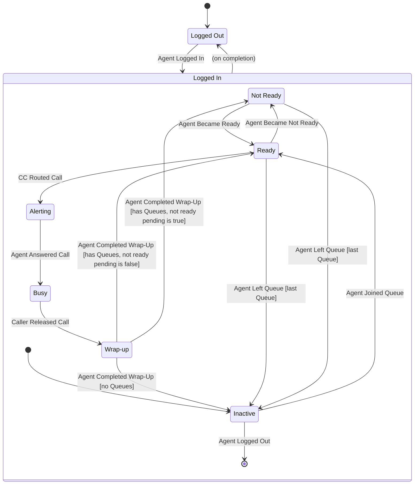
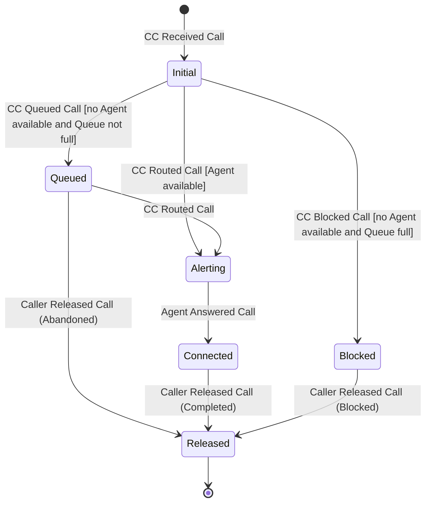

# Discrete-Event Simulation Model: Contact Center Simulator

## 1. Purpose & Scope

This document defines the domain model for a discrete-event simulation of a contact
center. It describes what the simulated contact center contains, how its parts behave,
what inputs drive it, and what it measures. It is the shared vocabulary and reference
for the Spec-Kit specifications that follow, and for judging whether the simulator's
behavior is correct.

The model is abstract. It describes the contact center as the simulation sees it, not
how the simulator is built.

<!--

This document describes the domain model for a discrete-event simulation of a contact
center. In this context, a "domain model" is a model of shared understanding of a unified *domain*, which
  combines elements from three constituent domains: contact center
  operations, simulation software design, and queueing theory.

Can we state more clearly the *purpose*? Here are some of my thoughts:

- Creating the simulation requires a collaboration between experts in three different domains: contact center
  operations, simulation software design, and queueing theory.
- This document attempts to convey a shared understanding of a unified *domain*, which
  combines elements from the three constituent domains.
- Provides information necessary for implementors, specifically: technical-oriented
  persons who have the necessary knowledge to create the software product.
- The document does not try to cover every aspect of contact center operations; it is limited to those
  aspects that are needed to create a simulator with limited scope.
- The initial scope is intentionally limited to reduce the simulation complexity.
  More specifically, the initial scope is limited to what is needed for a "minimum viable product" (MVP).

-->

### 1.1. In Scope

- **Inbound Voice Calls** - This model covers only inbound voice calls.
- **Entities** - The actors and objects in the simulated contact center (Callers,
  Calls, Agents, Queues, the Contact Center), their attributes, their states, and the
  relationships between them.
- **Events** - The things that happen in the contact center and change the state of
  one or more entities.
- **Behaviors** - The rules that determine how entities respond to events, including
  routing, queueing, blocking, and abandonment.
- **Parameters** - The inputs that make up a Scenario: the time frame, Call Volume,
  probability distributions, Queue settings, and Agent schedules.
- **Metrics** - The outputs the simulation reports, and what each one means.
- **Assumptions** - Simplifications the model makes, and the boundaries of the MVP.

### 1.2. Out of Scope

- **Other Channels** - Communication channels such as email, messaging, or outbound
  calls are out of scope.
- **Implementation** - Data structures, storage, how values are represented, which side
  of a relationship "owns" it, and how metrics are computed from simulation output (data
  collection, aggregation, algorithms). What each metric means — which Calls or time
  periods it counts, and its numerator and denominator — is in scope (Section 7).
- **Simulation engine mechanics** - Event scheduling, the simulation clock, random
  number generation, seeding, and variance-reduction techniques such as common random
  numbers.
- **Interfaces** - UI, CLI, APIs, and input/output file formats.
- **The staffing planner** - Using simulation results to recommend staffing levels or
  schedules. That belongs to a separate downstream specification.
- **Spec-Kit artifacts** - Feature specs, plans, and tasks. Those are derived from this
  document but are not part of it.

### 1.3. Scope Guidance

When it's unclear whether a detail belongs in this document, ask: *Does it change what
the simulated contact center does, or what a metric means?*

- If yes, it belongs here. Examples: whether an Agent can be offered a second Call while
  the first is ringing; whether a Caller can release a Call while it is ringing.
- If it only changes how the simulator stores, represents, or computes something, it
  belongs in the design. Examples: how an unbounded queue capacity is encoded; how the
  Agent-Queue membership is kept consistent in memory.

Relationships are described from the point of view of each entity involved. For
example, an Agent has the Queues it has joined, and a Queue has the Agents that have
joined it. Both describe the same relationship.

## 2. Terminology

This section defines the terms that are fundamental to the domain model. By explicitly
identifying these terms, we can use them consistently, not only in this domain document,
but also in other documents and in code. This section provides short definitions and
serves as a quick reference. Other sections provide more complete descriptions of the
terms.

[DS] I annotated some sentences as "Notes" in parenthesis. That's because these
sentences are explanatory and not essential to the definition. As such, they might be
better located elsewhere in the document. Furthermore, some of these notes provide
information that could be changed in a later revision of the document. Because they are
annotated, we could search for them from time to time to check that they are still
valid.

### 2.1. Contact Center Domain Terms

Concepts:

- **Contact Center** - A software component that receives Calls and connects them to
  Agents. See 3.1.2.
- **Caller** - A person who places a Call to the Contact Center. See 3.1.1.
- **Call** - A Caller's attempt to establish a voice session with an Agent. A Call
  starts when the Contact Center receives it and ends when the Caller releases it. If an
  Agent answers, the Call becomes a voice session between the Caller and the Agent.
  Otherwise it ends *Abandoned* or *Blocked*. See 3.2.1.
- **Agent** - A person who answers and handles Calls. See 3.1.3.
- **Queue** - A software component that implements a queue where Calls wait for an
  available Agent. See 3.2.2.
- **Join / Leave (a Queue)** - The operations by which an Agent starts or stops taking
  Calls from a Queue.
- **Routing** - The act of the Contact Center selecting an available Agent for a Call
  and alerting that Agent.
- **Alerting** - The period after a Call is routed to an Agent and before the Agent
  answers it (for example, the Agent's phone is ringing). The Call and the Agent are
  both *Alerting* during this period.
- **Wait Time** - The time a Caller waits for an Agent. For an answered Call,  it’s
  measured from *arrival timestamp* to *answer timestamp*. For an Abandoned Call, it’s
  measured from *arrival timestamp* to *release timestamp*.
- **Alert Time** - The time a Call spends *Alerting*, measured from *alert timestamp* to
  *answer timestamp*. An *Alerting* Call has been routed and has an assigned Agent, so
  Alert Time is a measurable quantity for both Calls and Agents.
- **Talk Time** - The time an Agent spends connected to a Call, measured from *answer
  timestamp* to *release timestamp*.
- **Wrap-up** - The work an Agent does after a Call is released and before taking
  another Call, such as entering notes. Also called after-call work (ACW) elsewhere in
  the industry.
- **Wrap-up Time** - The time an Agent spends in Wrap-up for one Call, measured from
  *release timestamp* to *wrap-up end timestamp*.
- **Handle Time** - The total Agent time a Call consumes, equal to Talk Time plus Wrap-up Time.
- **Disposition** - The final outcome of a Call: *Completed*, *Abandoned*, or *Blocked*.
- **Abandoned Call** - A Call the Caller releases while it is waiting in a Queue. (Note: A
  Caller cannot release a Call while it is *Alerting*, so every Abandoned Call is
  released from the Queue.)
- **Blocked Call** - A Call the Contact Center rejects on arrival, typically because the
  destination Queue is full.
- **Policy** - A configurable rule set that governs Contact Center behavior. The
  Queueing Policy covers routing, blocking, and Queue capacity. The Staffing Policy
  covers how many Agents are working, and when. See 5.3.
- **Interval** - A fixed period, commonly 15 or 30 minutes, over which input parameters
  are held constant and metrics are reported. (Note: Each Call belongs to exactly one
  Interval: the one containing its *arrival timestamp* (see 7.1).)

Metrics:

- **Call Volume** - The number of Calls the Contact Center receives in an Interval. As
  an input, it is expressed as an arrival rate (Section 6).([DS] Check the previous
  sentence.) As an output, it is the observed count.
- **AHT (Average Handle Time)** - The mean Handle Time of the answered Calls that
  belong to an Interval.
- **ASA (Average Speed of Answer)** - The mean Wait Time of the answered Calls that
  belong to an Interval.
- **Service Level (SL)** - The percentage of Calls answered within the *Service Level
  Threshold*, a duration such as 20 seconds. Which Calls are counted, and how Abandoned
  and Blocked Calls are treated, is defined in Section 7. A goal such as "80% within 20
  seconds" is a Service Level Target, not the metric itself (see Section 8).
- **Abandonment Rate** - The fraction of non-Blocked Calls that end *Abandoned*.
- **Block Rate** - The fraction of received Calls that end *Blocked*.
- **Queue Length** - The number of Calls waiting in a Queue at a given moment, reported
  as an average, a maximum, or a series over time. ([DS] The definition is awkward. It
  suggests Queue Length is measured at an instant in time (“at a given moment”), but
  then mentions quantities measured over an interval (“average”, “maximum”).)
- **Occupancy** - The fraction of an Agent's available time spent on Calls. The
  numerator is time in *Alerting*, *Busy*, and *Wrap-up*. The denominator is time in
  *Ready*, *Alerting*, *Busy*, and *Wrap-up*. *Not Ready* time is excluded. *Alerting*
  counts as time spent on Calls because an Alerting Agent cannot take another Call.
  (Some ACDs report ringing time as available time, so their Occupancy can be slightly
  lower than this model's.)
- **Utilization** - The fraction of an Agent's logged-in time spent on Calls. The
  numerator is the same as for Occupancy. Unlike Occupancy, the denominator includes
  *Not Ready* and *Inactive* time. The industry uses these two terms inconsistently, so
  this document uses these definitions.

### 2.2. Queueing Theory Terms (reference only)

[DS] This section needs to be better focused. It contains a lot of explanations that are
relevant to the document, but which do not fit well into this section.

This section covers terms from queueing theory, a mathematical discipline that studies
the behavior of queueing models. The terms defined here relate to the well-known
mathematical formulas that describe the behavior of specific queueing models.

The simulator does not use these formulas. However, they are useful for validation:
under matching assumptions, the simulation’s results should agree with the formula’s
predictions. For example, with Poisson arrivals, an unbounded Queue, no abandonment,
zero Alert Time, zero Wrap-up Time, and exponential Talk Time, simulated results should
match Erlang C. Erlang A additionally requires exponential Caller *patience*. Because
the formulas describe steady state, the comparison uses the middle Intervals of a long
run (see Section 9, Validation runs).

Zero Alert Time and zero Wrap-up Time are needed for an exact match for two reasons.
First, the formulas assume an exponential Service Time, and a sum of Alert Time, Talk
Time, and Wrap-up Time is not exponential even when each part is. Second, the formulas
measure waiting until service starts (routing, the *alert timestamp*), while Wait Time
runs until the *answer timestamp*; the two agree only when Alert Time is zero.

- **Arrival Rate (λ)** - The average number of Calls arriving per unit of time.
- **Poisson Arrival Process** - An arrival pattern in which Calls (a) arrive
  independently at a constant average rate and (b) the times between arrivals are
  exponentially distributed. Most analytic models assume it.
- **Service Time (1/μ)** - The average time a server spends on one customer. In this
  model, an Agent is occupied by a Call from *alert timestamp* to *wrap-up end
  timestamp*, so Service Time is the mean of Alert Time plus Handle Time. It equals AHT
  only when Alert Time is zero.
- **Servers (N)** - The number of parallel servers. In this model, that is the number
  of Agents handling Calls.
- **Erlang** - The unit of traffic intensity. One Erlang is one server kept
  continuously busy.
- **Offered Load (A)** - The traffic demand in Erlangs: A = λ × (1/μ). For example,
  120 Calls per hour with a 5-minute Service Time is 10 Erlangs.
- **Server Utilization (ρ)** - The fraction of server capacity in use: ρ = A / N. In
  steady state, it corresponds to the contact-center Occupancy metric, because both
  count *Alerting* time as occupied.
- **Erlang B** - A formula for the probability that a Call is blocked when there is no
  Queue (blocked Calls are lost). This corresponds to a Queue with a capacity of zero.
- **Erlang C** - A formula for the probability that a Call must wait, and for its
  expected Wait Time. It assumes an unbounded Queue and no abandonment (M/M/N).
- **Erlang A** - An extension of Erlang C that adds abandonment, assuming exponentially
  distributed Caller patience (M/M/N+M).

### 2.3. Simulation Terms

- **Entity** - Any Actor or Object in the model (Section 3). Note that simulation
  literature often uses "entity" narrowly, for the items that flow through the system
  (here, Calls). This document uses it in the broader sense.
- **Actor** - An Entity that initiates Events: a Caller, an Agent, or the Contact
  Center.
- **Object** - An Entity that is acted on but does not initiate Events: a Call or a
  Queue.
- **Attribute** - A named property of an Entity, such as a Caller's *patience* or a
  Call's *arrival timestamp*.
- **State** - The value of an Entity's *state* Attribute at a point in time. Examples
  are an Agent's *activity state* and a Call's *state*.
- **Event** - A point-in-time occurrence that changes the State of one or more
  Entities. Events are listed in Section 4.
- **Transition** - A change from one State to another, triggered by an Event and
  sometimes subject to a condition. Transitions are specified in Section 5.
- **Distribution** - A probability distribution from which the simulation samples
  random values, such as a Caller's *patience*. Distributions are specified in
  Section 6.
- **Simulation Time** - The model's clock: the timeline on which all timestamps, such
  as *arrival timestamp*, are recorded. It is not wall-clock time. Simulation Time is
  neither a duration nor a timestamp, so it is an exception to the naming rule in 2.4.
- **Scenario** - A complete set of input parameter values that define a Replication.
  Also called a *design point* or *configuration*. ([DS] The preceding sentence is a
  little misleading if we never use those alternate terms in any of our documents. If
  the alternate terms are used elsewhere in the simulation domain, we should say that
  that’s the case.) "Complete" means the model has no hidden defaults: everything that
  affects what the simulated contact center does is set in the Scenario. Two
  Replications of the same Scenario differ only in their random values. The Scenario's
  values are listed in Section 6.
- **Parameter** - A value set by the Scenario. A value belongs in the Scenario if it can
  differ between Scenarios and changes what happens in a Replication. A rule the model
  fixes, such as FIFO Call selection (5.3.1), is not a parameter: it cannot vary, so it
  is not a hidden default. A value that changes only how Replications are run or how
  results are measured, such as the number of Replications or the Service Level
  Threshold, is not a parameter either (see 6.7). An Attribute differs from a
  parameter: it is a property of an Entity, which may be set from a parameter (for
  example, a Queue's *capacity*) or may change during a Replication (for example, an
  Agent's *activity state*).
- **Replication** - One independent execution of the model for a given Scenario. Because
  inputs are random, each Replication produces different results. Metrics are
  computed for each Replication and then summarized across Replications; Calls are
  not pooled across Replications.
- **Experiment** - A set of Scenarios run together for comparison. For example, 38 to 46
  Agents in steps of 2. This is the sense used in design of experiments. Note: How
  randomness is shared across Scenarios is a design concern (see 1.2).

### 2.4. Conventions

When a term (word or phrase) refers to a concept defined in this model, the term is
capitalized. For example, a "Queue" is an object that is explicitly defined by the
model, whereas a "queue" is to be understood in a general sense.

Defined terms distinguish durations from points in time:

- A term ending in *Time* is a duration. Examples: Talk Time, Wait Time, Handle Time,
  and Wrap-up Time. This follows standard contact center usage.
- A term ending in *timestamp* is a point in Simulation Time. Examples: *arrival
  timestamp* and *answer timestamp*.

This rule applies only to defined terms. The word "time" in ordinary phrases, such as
"over time" or "at any time", keeps its everyday meaning. Standard industry names that
do not follow the pattern, such as ASA (Average Speed of Answer), are kept as they are.

## 3. Entities

### 3.1. Actors

#### 3.1.1. Caller

A Caller makes a Call to the Contact Center. A Caller can release (hang up) the Call at
any time. This model assumes a 1:1 pairing between a Caller and a Call.

In this model, a Caller's behavior is controlled by one Attribute: *patience*. Its value
is different for each Caller and is sampled from the *patience distribution* of the
Call's Queue (see 3.2.2 and 6.3). Note that this Attribute also applies to the Call due
to its 1:1 association to the Caller.

The duration of a Call is not a property of the Caller. Talk Time and Wrap-up Time are
sampled from distributions that belong to the Queue (see 3.2.2).

Attributes

- *identity* - A unique identifier for the Caller. This value may be recorded in log messages.
- *patience* - How long the Caller will wait in the Queue before releasing the Call.
  It is measured from the *arrival timestamp*, which is also when the Call entered the
  Queue (see 3.2.1). *patience* can be unlimited, meaning the Caller never abandons.

**Notes**:

- *patience* matters only for a queued Call. The Caller releases a *Queued* Call
  (Caller Released Call, disposition Abandoned) when *patience* has elapsed after the
  *arrival timestamp*, unless the Call is routed first. A Call that is routed or
  Blocked on arrival never uses *patience*, so the model sets it only when the Call is
  queued (see 5.2). Sampling a value for every Call instead, for example to keep random
  numbers aligned across Scenarios, is a design choice (see 1.2); it does not change the
  model's behavior.
- A Caller cannot release an *alerting* Call. This is mainly a simplifying assumption.
  We assume that during the alerting, the Caller hears ringback, announcement, or other
  treatment that indicates (to the Caller) that his Call will be answered shortly.

#### 3.1.2. Contact Center

Fundamentally, a Contact Center is a software component that receives Calls and connects
them to Agents. When no Agent is immediately available, the Contact Center adds the Call
to a Queue to wait for an Agent. When an Agent becomes available, the Contact Center
routes the Call to that Agent. The Contact Center may manage multiple Queues, each
according to its Queueing Policy (Section 5).

A simulation has one Contact Center.

Attributes:

- *queues* - The Queues managed by the Contact Center.
- *agents* - The list of Agents that are in the simulation.

**Notes**:

- In the MVP, there is only one Contact Center and one Queue.
- The Contact Center maintains a master list of Agents, including Agents that have not
  logged in or joined a Queue.

#### 3.1.3. Agent

An Agent handles Calls. To handle a Call, an Agent answers a Call and remains on the
Call until the Caller releases it. After the Caller releases the Call, the Agent
completes a wrap-up activity before becoming available to handle another Call.

An Agent *joins* a Queue, which means the Agent can handle Calls received for that Queue. An
Agent can join multiple Queues. An Agent can *leave* (unjoin) a Queue.

An Agent has state and attributes.

Attributes:

- *identity* - A unique identifier for the Agent. This identifier can appear in log
  messages. It may also be used to generate per-Agent metrics.
- *queues* - The list of Queues the Agent has joined.
- *session state* - A dynamic state attribute that tracks an Agent's work availability. (See values below.)
- *activity state* - A dynamic state attribute that tracks an Agent's work activity.
- *not ready pending* - The Agent has requested to become *Not Ready*. When this Boolean
  attribute is "true", the next activity state transition that would otherwise go to
  *Ready* will instead go to *Not Ready*.

Session State:

- *Logged In* - The Agent can join a Queue and handle Calls.
- *Logged Out* - The Agent is not joined to any Queues, cannot join any Queues, and
  cannot handle Calls.

Activity State:

- *Inactive* - The Agent has not joined any Queue and is not handling a Call.
- *Ready* - The Agent is currently able to handle a Call.
- *Alerting* - The Contact Center has routed a Call to the Agent, but the Agent has not
  yet answered.
- *Busy* - The Agent is currently handling a Call.
- *Wrap-up* - The Agent is performing wrap-up activity. In this state, the
  Agent is unable to handle a new Call.
- *Not Ready* - The Agent is not ready to handle a Call (for example, on a
  break).

**Notes**:

- In the MVP, an Agent can join only one Queue.
- An Agent must leave all Queues before he can log out.
- An Agent handles at most one Call at a time. The Contact Center routes a Call only to
  an Agent whose activity state is Ready and who has joined the Call's Queue. Such an
  Agent is called an available Agent. An Agent who is Alerting, Busy, in Wrap-up, or Not
  Ready is not offered another Call.
- The *Alerting* state tracks the *Alerting* state of the Call. During this time, the
  Contact Center can provide to the Agent a whisper message or information about the
  Caller.
- An Agent must complete in-progress Call-related activity before he can become *Not
  Ready*. If the Agent is in *Alerting*, *Busy*, or *Wrap-up*, he can request to become
  *Not Ready* after *Wrap-Up*. This request changes the Agent's *not ready pending*
  attribute to "true". After the Agent completes Wrap-Up, his state changes to *Not
  Ready* instead of *Ready*. 
- An Agent can leave a Queue at any time. Leaving removes the Agent from the Queue's
  roster, so the Contact Center routes no more Calls from that Queue to the Agent. It
  does not affect a Call the Agent is already handling: that Call stays with the Agent
  (the Call's *agent* attribute) through answer, Talk Time, and Wrap-up.
- If an Agent leaves his last Queue while in *Alerting*, *Busy*, or in *Wrap-up*, his
  activity state does not change. When he completes Wrap-up, he goes to *Inactive*
  instead of *Ready* or *Not Ready*.

**Measured Times**:

The timeline below shows one Agent over about 13 minutes: the Agent joins a Queue,
handles two Calls, requests Not Ready during the 2nd Call, takes a break, and then
becomes Ready again. Each lane shows the time spent in one *activity state*. The
lower three lanes show the time that feeds Occupancy and Utilization (see 2.1).

```mermaid
---
config:
  gantt:
    displayMode: compact
    leftPadding: 170
  themeVariables:
    sectionBkgColor: "#c9d6f0"
    altSectionBkgColor: "#ffffff"
    sectionBkgColor2: "#c9d6f0"
  themeCSS: ".section0, .section1, .section2, .section3 { opacity: 0.35; }"
---
gantt
    title Agent activity: measured times (example)
    dateFormat HH:mm:ss
    axisFormat %M:%S
    tickInterval 1minute

    section Inactive
    Inactive            :i1, 00:00:00, 00:00:30

    section Ready
    Ready               :r1, 00:00:30, 00:01:30
    Ready               :r2, 00:05:45, 00:06:15
    Ready               :r3, 00:12:30, 00:13:20

    section Alerting (Alert Time)
    1st Call            :active, a1, 00:01:30, 00:01:45
    2nd Call            :active, a2, 00:06:15, 00:06:30

    section Busy (Talk Time)
    1st Call            :active, b1, 00:01:45, 00:04:45
    2nd Call            :active, b2, 00:06:30, 00:08:30

    section Wrap-up (Wrap-up Time)
    1st Call            :active, w1, 00:04:45, 00:05:45
    2nd Call            :active, w2, 00:08:30, 00:09:30

    section Not Ready
    Not Ready           :n1, 00:09:30, 00:12:30

    section On Calls
    On Calls            :crit, o1, 00:01:30, 00:05:45
    On Calls            :crit, o2, 00:06:15, 00:09:30

    section Available
    Available           :done, v1, 00:00:30, 00:09:30
    Available           :done, v2, 00:12:30, 00:13:20

    section Logged In
    Logged In           :done, l1, 00:00:00, 00:13:20
```

- *On Calls* is time in *Alerting*, *Busy*, and *Wrap-up*: 4:15 + 3:15 = 7:30.
- *Available* adds *Ready* time to *On Calls*: 7:30 + 2:20 = 9:50.
- *Logged In* adds *Not Ready* and *Inactive* time: 9:50 + 3:00 + 0:30 = 13:20.
- Occupancy = 7:30 / 9:50 = 76%. Utilization = 7:30 / 13:20 = 56%.

### 3.2. Objects

#### 3.2.1. Call

A Call represents a Caller's attempt to talk to an Agent. It is the unit of demand in
the model: each Call arrives once, travels through the Contact Center, and ends with
exactly one *disposition*. The Contact Center is the path the Call takes, not the other
party. The Call's purpose is to reach an Agent, and only a Call that reaches an Agent
accrues Talk Time and Handle Time.

Attributes:

- *identity* - A unique identifier for the Call. This identifier can appear in log
  messages.
- *caller* - The Caller who placed the Call.
- *queue* - The Call's destination Queue.
- *agent* - The Agent who handled (or is handling) the Call.
- *state* - The state of the Call.
- *arrival timestamp* - When the Contact Center received the Call. The model assumes
  the Contact Center instantly processes new incoming Calls. Therefore, if the Call is
  queued, the *arrival timestamp* is also when the Call entered the Queue.
- *alert timestamp* - When the Contact Center routed the Call to an Agent.
- *answer timestamp* - When the Agent answered the Call.
- *release timestamp* - When the Caller released the Call.
- *wrap-up end timestamp* - When the Agent completed Wrap-up for this Call.
- *disposition* - The final disposition of the Call: Completed / Abandoned / Blocked.

State:

- *Initial* - This is the initial state of a new Call.
- *Queued* - The Contact Center added the Call to the destination Queue.
- *Alerting* - The Contact Center routed the Call to an Agent. The Agent has not yet answered the Call.
- *Connected* - The Agent has answered the Call.
- *Released* - The Caller has released the Call.
- *Blocked* - The Contact Center blocked the Call and is giving the Caller treatment
  (for example, a busy tone or an announcement) until the Caller releases the Call. In
  this model, treatment lasts zero time (see 5.2).

**Notes**:

- This model assumes the Caller always releases the Call.
  - Rationale: This assumption allows us to define one event to end a call, and that one
    event can follow the same naming convention as other events, namely, *actor*
    *action* [*direct object*]. An alternative would be to name the event "X Releases
    Call", where "X" represents an unspecified actor, or name the event "Call Released",
    which is passive voice and doesn't follow the naming convention.
- A Call is also the record of all activity around it. Its timestamps capture each stage
  from arrival to the end of the Agent's Wrap-up, so every duration (Wait Time, Talk
  Time, Wrap-up Time) is derived from them. The Call's *state* ends at *Released*, but
  its record is complete only when the *wrap-up end timestamp* is set.

**Measured Times**:

Every duration of a Call is the difference between two of its timestamps. The timeline
below shows a Completed Call. Note that Wait Time and Alert Time overlap: the Caller is
still waiting while the Agent is being alerted. Handle Time (Talk Time plus Wrap-up
Time) is what AHT averages. Service Time, the queueing-theory term (see 2.2), also
includes Alert Time, because the Agent is occupied from the *alert timestamp*.

```mermaid
---
config:
  themeVariables:
    sectionBkgColor: "#c9d6f0"
    altSectionBkgColor: "#ffffff"
    sectionBkgColor2: "#c9d6f0"
  themeCSS: ".section0, .section1, .section2, .section3 { opacity: 0.35; }"
---
gantt
    title Completed Call: measured times (example)
    dateFormat HH:mm:ss
    axisFormat %M:%S
    tickInterval 30second

    section Timestamps
    arrival             :milestone, t1, 00:00:00, 0s
    alert               :milestone, t2, 00:00:45, 0s
    answer              :milestone, t3, 00:01:00, 0s
    release             :milestone, t4, 00:04:00, 0s
    wrap-up end         :milestone, t5, 00:05:00, 0s

    section Call state
    Queued              :s1, 00:00:00, 00:00:45
    Alerting            :s2, 00:00:45, 00:01:00
    Connected           :s3, 00:01:00, 00:04:00
    Released            :milestone, s4, 00:04:00, 0s

    section Caller
    Wait Time           :crit, c1, 00:00:00, 00:01:00

    section Agent
    Alert Time          :active, a1, 00:00:45, 00:01:00
    Talk Time           :active, a2, 00:01:00, 00:04:00
    Wrap-up Time        :active, a3, 00:04:00, 00:05:00

    section Derived
    Handle Time         :done, d1, 00:01:00, 00:05:00
    Service Time        :done, d2, 00:00:45, 00:05:00
```

An Abandoned Call has only an *arrival timestamp* and a *release timestamp*. Its Wait
Time is the whole time it spent Queued, and it has no Alert Time, Talk Time, or Wrap-up
Time. A Blocked Call has no measured times.

```mermaid
---
config:
  themeVariables:
    sectionBkgColor: "#c9d6f0"
    altSectionBkgColor: "#ffffff"
    sectionBkgColor2: "#c9d6f0"
  themeCSS: ".section0, .section1, .section2, .section3 { opacity: 0.35; }"
---
gantt
    title Abandoned Call: measured times (example)
    dateFormat HH:mm:ss
    axisFormat %M:%S
    tickInterval 15second

    section Timestamps
    arrival             :milestone, t1, 00:00:00, 0s
    release             :milestone, t2, 00:01:10, 0s

    section Call state
    Queued              :s1, 00:00:00, 00:01:10

    section Caller
    Wait Time           :crit, c1, 00:00:00, 00:01:10
```

#### 3.2.2. Queue

A Queue (object) implements a queue where Calls wait for an available Agent.

Attributes:

Attributes set by the Scenario (see 6.3 and 6.4), which do not change during a
Replication:

- *identity* - A unique identifier for the Queue. This identifier can appear in log
  messages. In a multi-Queue scenario, the identifier enables per-Queue metrics.
- *capacity* - The maximum number of Calls that can wait in the Queue: a whole number
  (zero or more) or unlimited. Zero and unlimited are needed for validation against
  queueing theory (see 2.2 and 5.3).
- *alert time distribution* - The probability distribution from which the Alert Time of
  each Call routed from this Queue is sampled.
- *talk time distribution* - The probability distribution from which the Talk Time of
  each answered Call to this Queue is sampled.
- *wrap-up time distribution* - The probability distribution from which the Wrap-up
  Time of each answered Call to this Queue is sampled.
- *patience distribution* - The probability distribution from which the *patience* of
  the Caller of each queued Call to this Queue is sampled (see 3.1.1).

Attributes that change during a Replication:

- *calls* - The queue of Calls in the Queue.
- *agents* - The roster of Agents who have joined the Queue.

**Notes**:

- In the MVP, Alert Time, Talk Time, and Wrap-up Time are sampled independently of each
  other, of the Caller's *patience*, and of the Agent who answers the Call. The model
  must not rule out adding a correlation between Talk Time and Wrap-up Time later (for
  example, a correlation parameter on the Queue).
- The Agent answers an Alerting Call (Agent Answered Call) when its sampled Alert Time
  has elapsed after the *alert timestamp*.
- The Caller releases a Connected Call (Caller Released Call) when its sampled Talk Time
  has elapsed after the *answer timestamp*. Caller Released Call is the Event that ends
  the Call.
- The Agent completes Wrap-up (Agent Completed Wrap-Up) when the sampled Wrap-up Time
  has elapsed after the *release timestamp*.

## 4. Events

- **CC Received Call** - The Contact Center received a new incoming Call.
- **CC Queued Call** - The Contact Center added the Call to a Queue.
- **CC Routed Call** - The Contact Center alerted an Agent.
- **CC Blocked Call** - The Contact Center blocked a new incoming Call.
- **Agent Logged In** - The Agent started his work shift.
- **Agent Joined Queue** - An Agent joined a Queue and is on the roster to handle Calls
  to that Queue.
- **Agent Answered Call** - An Agent answered a Call.
- **Caller Released Call** - The Caller released the Call.
- **Agent Completed Wrap-Up** - An Agent completed the wrap-up activity.
- **Agent Requested Not Ready** - An Agent wants to become Not Ready instead of Ready
  after completing his current activity. It applies only while the Agent is *Alerting*,
  *Busy*, or in *Wrap-up*. A *Ready* Agent uses Agent Became Not Ready instead.
- **Agent Became Not Ready** - An Agent made himself unavailable to handle Calls. (For
  example, the Agent went on break.)
- **Agent Became Ready** - An Agent made himself available to handle Calls.
- **Agent Left Queue** - An Agent left a Queue (unjoined the Queue) and is no longer on
  the roster to handle Calls to that Queue.
- **Agent Logged Out** - An Agent ended his work shift.

Remarks:

- **CC Routed Call** - This event can happen immediately after CC Received Call if an
  Agent is available to handle the Call. Alternatively, if the Call is in a
  Queue, the event happens when an Agent becomes available. In the latter case, the
  Contact Center "dequeues" the Call.
- **CC Blocked Call** - In a real Contact Center, this event can happen for various
  reasons. In the MVP, the only reason is that no Agent is available and the destination
  Queue is full (see 5.3).
- **Agent Joined Queue** / **Agent Left Queue** - These events model Agent staffing
  actions. When an Agent starts a shift, he joins one or more Queues. When he ends
  his shift, he leaves all Queues. Agent Left Queue takes effect immediately in any
  activity state; it stops new Calls from that Queue but does not affect a Call the
  Agent is already handling (see 3.1.3).

## 5. Behaviors / Transition Rules

- State diagram or transition table combining events into full system
  behavior
- Handling of Queue capacity
- Handling of abandonment

### 5.1. Agent State Transitions

The *activity state* applies only while the Agent's *session state* is *Logged In*, so
it is shown nested inside *Logged In*. Transition labels are Events from Section 4,
except "(on completion)", which marks a completion transition (see Notes). Labels in
square brackets are conditions.

Session State Transitions:

| Current State | Event | Condition(s) | Next State |
|---|---|---|---|
| Logged Out | Agent Logged In | | Logged In |
| Logged In | Agent Logged Out | *activity state* is Inactive | Logged Out |

Activity State Transitions (apply only while *session state* is *Logged In*):

| Current State | Event | Condition(s) | Actions | Next State |
|---|---|---|---|---|
| — (entering *Logged In*) | Agent Logged In | | | Inactive |
| Inactive | Agent Joined Queue | | Add Agent to Queue's *agents* / Add Queue to Agent's *queues* | Ready |
| Ready | CC Routed Call | | | Alerting |
| Alerting | Agent Requested Not Ready | | Set *not ready pending* to "true" | Alerting |
| Alerting | Agent Left Queue | | Remove Agent from Queue's *agents* / Remove Queue from Agent's *queues* | Alerting |
| Alerting | Agent Answered Call | | | Busy |
| Busy | Agent Requested Not Ready | | Set *not ready pending* to "true" | Busy |
| Busy | Agent Left Queue | | Remove Agent from Queue's *agents* / Remove Queue from Agent's *queues*  | Busy |
| Busy | Caller Released Call | | | Wrap-up |
| Wrap-up | Agent Requested Not Ready | | Set *not ready pending* to "true" | Wrap-up |
| Wrap-up | Agent Left Queue | | Remove Agent from Queue's *agents* / Remove Queue from Agent's *queues*  | Wrap-up |
| Wrap-up | Agent Completed Wrap-Up | *queues* is empty | Set *not ready pending* to "false" | Inactive |
| Wrap-up | Agent Completed Wrap-Up | *queues* is not empty; *not ready pending* is "false" | | Ready |
| Wrap-up | Agent Completed Wrap-Up | *queues* is not empty; *not ready pending* is "true" | Set *not ready pending* to "false" | Not Ready |
| Ready | Agent Became Not Ready | | | Not Ready |
| Not Ready | Agent Became Ready | | | Ready |
| Ready | Agent Left Queue | last Queue | Remove Agent from Queue's *agents* / Remove Queue from Agent's *queues*  | Inactive |
| Ready | Agent Left Queue | not last Queue | Remove Agent from Queue's *agents* / Remove Queue from Agent's *queues*  | Ready |
| Not Ready | Agent Left Queue | last Queue | Remove Agent from Queue's *agents* / Remove Queue from Agent's *queues*  | Inactive |
| Not Ready | Agent Left Queue | not last Queue | Remove Agent from Queue's *agents* / Remove Queue from Agent's *queues*  | Not Ready |
| Inactive | Agent Logged Out | | | — (leaving *Logged In*) |

**Notes**:

- Agent Left Queue can happen in any activity state except *Inactive*. While *Alerting*,
  *Busy*, or in *Wrap-up*, it only removes the Agent from the Queue's roster; the Agent finishes
  the Call and goes to *Inactive* at the end of Wrap-up if no Queues remain (see 3.1.3).
  The diagram omits these self-transitions and the Agent Requested Not Ready
  self-transitions; the table lists them.
- The Agent can log out only from *Inactive*. In the diagram, Agent Logged Out moves the
  Agent to the final state of *Logged In*; the edge labeled "(on completion)" from
  *Logged In* to *Logged Out* is a completion transition that fires when that final
  state is reached. It is not a second way to log out. The Session State table states
  the same rule directly, as a condition on Agent Logged Out.
- The rows marked "—" in the Activity State table are where the two tables meet:
  logging in starts the *activity state* at *Inactive*, and logging out ends it.

### 5.2. Call State Transitions

Transition labels are Events from Section 4. Labels in square brackets are conditions,
and labels in parentheses are the *disposition* the path sets.

Call State Transitions:

| Current State | Event | Condition(s) | Actions | Next State |
|---|---|---|---|---|
| — (new Call) | CC Received Call | | Set *arrival timestamp* / Set *queue* to the destination Queue | Initial |
| Initial | CC Routed Call | an available Agent has joined the Call's *queue* | Set *agent* / Set *alert timestamp* | Alerting |
| Initial | CC Queued Call | no available Agent; Queue is not full | Add Call to Queue's *calls* / Set Caller's *patience* | Queued |
| Initial | CC Blocked Call | no available Agent; Queue is full | | Blocked |
| Queued | CC Routed Call | | Remove Call from Queue's *calls* / Set *agent* / Set *alert timestamp* | Alerting |
| Queued | Caller Released Call | | Remove Call from Queue's *calls* / Set *release timestamp* / Set *disposition* to Abandoned | Released |
| Alerting | Agent Answered Call | | Set *answer timestamp* | Connected |
| Connected | Caller Released Call | | Set *release timestamp* / Set *disposition* to Completed | Released |
| Blocked | Caller Released Call | | Set *release timestamp* / Set *disposition* to Blocked | Released |
| Released | Agent Completed Wrap-Up | *disposition* is Completed | Set *wrap-up end timestamp* | Released |

**Notes**:

- The Call's *disposition* is set by the path into the final state. Released from
  *Queued* is Abandoned, from *Connected* is Completed, and from *Blocked* is
  Blocked. The table sets it on entering *Released*, so every Call that has ended has
  exactly one *disposition*, and a Call that has not ended has none.
- The table lists only Events that change the Call's *state* or its record. What each
  Event does to the Agent is in 5.1; Agent Answered Call, Caller Released Call, and
  Agent Completed Wrap-Up appear in both tables.
- When timed Events occur is set by the sampled durations: Agent Answered Call when
  Alert Time has elapsed after the *alert timestamp*, Caller Released Call from
  *Connected* when Talk Time has elapsed after the *answer timestamp*, and Agent
  Completed Wrap-Up when Wrap-up Time has elapsed after the *release timestamp* (see
  3.2.2). Caller Released Call from *Queued* occurs when the Caller's *patience* has
  elapsed after the *arrival timestamp* (see 3.1.1).
- The last row is a self-transition on the final state. The Call's *state* no longer
  changes after *Released*, but its record is not complete until the Agent finishes
  Wrap-up (see 3.2.1). The diagram omits this row.
- *Blocked* lasts zero time: Caller Released Call follows CC Blocked Call immediately,
  so a Blocked Call's *release timestamp* equals its *arrival timestamp*. A real Contact
  Center may play an announcement before disconnecting, but that time does not matter
  here. A Blocked Call does not occupy the Queue or an Agent, and every metric counts it
  by its *arrival timestamp*, so a non-zero time would change no result (see Section 9).
- *Initial* lasts zero time, because the model assumes the Contact Center processes
  new Calls instantly (see *arrival timestamp* in 3.2.1).
- There is no *Alerting* → *Released* transition, because a Caller cannot release an
  *Alerting* Call (see 3.1.1).

### 5.3. Policies

#### 5.3.1. Queueing Policy

The Queueing Policy decides what happens to a Call on arrival, which Agent gets a Call,
and which waiting Call an Agent gets. In the MVP:

- **Queue capacity.** *capacity* counts only Calls waiting in the Queue (*Queued*).
  Calls that are *Alerting* or *Connected* do not count. The Queue is full when the
  number of Calls in its *calls* equals its *capacity*.
  - A *capacity* of zero means no Call ever waits: each Call is routed or Blocked on
    arrival. This matches Erlang B (2.2).
  - An unlimited *capacity* means no Call is ever Blocked. This matches Erlang C and
    Erlang A (2.2).
- **On arrival.** If an Agent is available, the Contact Center routes the Call (CC
  Routed Call). Otherwise, if the Queue is not full, it queues the Call (CC Queued
  Call). Otherwise, it blocks the Call (CC Blocked Call). A full Queue is the only
  reason a Call is Blocked.
- **Agent selection: longest idle.** When more than one Agent is available for an
  arriving Call, the Contact Center routes it to the Agent who has been *Ready* the
  longest, that is, the Agent whose most recent entry into *Ready* is earliest.
- **Call selection: FIFO.** When an Agent becomes available and Calls are waiting, the
  Contact Center routes the Call that has waited the longest, that is, the Call with the
  earliest *arrival timestamp*. An Agent becomes available by entering *Ready* while
  joined to the Queue: by Agent Joined Queue, Agent Became Ready, or Agent Completed
  Wrap-Up.

**Notes**:

- Only one of the two selection rules applies at any moment. Because routing is
  instant, Calls wait only when no Agent is available, and Agents wait in *Ready* only
  when no Calls are waiting.
- Two Agents can enter *Ready* at the same Simulation Time, for example when both join
  the Queue at the start of a shift. They are processed in order of Agent *identity*,
  so the lowest-*identity* Agent receives a waiting Call (see 5.4).
- Longest idle does not change aggregate metrics when Agents are identical. It does
  change per-Agent metrics (Occupancy, Utilization), because it spreads Calls evenly
  across Agents.

#### 5.3.2. Staffing Policy

The Staffing Policy decides when each Agent works and is available. In the MVP, it
follows the Agent schedules in the Scenario (6.5). Each Agent has one shift and may have
breaks. The schedule produces these Agent Events:

- At the *login timestamp*: Agent Logged In, then Agent Joined Queue.
- At each break's start: Agent Became Not Ready.
- At each break's end: Agent Became Ready.
- At the *logout timestamp*: Agent Left Queue, then Agent Logged Out.

Agent Requested Not Ready is not used by the MVP schedule unless OQ-13 decides that a
break starting while the Agent is on a Call uses it.

**Notes**:

- The schedule is the canonical form of staffing. An Agent count per Interval, such as
  an Erlang-based staffing curve, does not say which Agents leave or when, so it is not
  a Scenario parameter. A client, such as the staffing planner, converts a count into
  Agent schedules before it submits the Scenario (see 1.2).
- A scheduled Agent Event can occur while the Agent is in a state where it has no row
  in 5.1, for example, a *logout timestamp* while the Agent is *Busy*. Those cases are
  OQ-13. How scheduled logouts interact with the drain (Section 9) is OQ-25.

### 5.4. Simultaneous and Stale Events

Events are instantaneous, and more than one can occur at the same Simulation Time. The
model processes them one at a time. Where the order could change the outcome, the rules
below fix it, so the outcome never depends on how the simulator stores its Events.

- **Zero-time chains.** Some Events cause others at the same instant. CC Received Call
  leads immediately to CC Routed Call, CC Queued Call, or CC Blocked Call, and CC Blocked
  Call leads immediately to Caller Released Call. When Alert Time is zero, CC Routed Call
  leads immediately to Agent Answered Call. When Wrap-up Time is zero, Caller Released
  Call leads immediately to Agent Completed Wrap-Up, which may lead to CC Routed Call for
  the next waiting Call. Each Event is processed completely, including the chain it
  starts, in cause-and-effect order, before the next independent Event.
- **Independent Events at the same instant.** These are processed in this order:
  1. Caller Released Call
  2. Agent Events (Agent Logged In, Agent Joined Queue, Agent Answered Call, Agent
     Completed Wrap-Up, Agent Requested Not Ready, Agent Became Not Ready, Agent Became
     Ready, Agent Left Queue, Agent Logged Out)
  3. CC Received Call

  Within a group, Events are processed in order of *identity*, lowest first: Call
  *identity* for Caller Released Call and CC Received Call, Agent *identity* for Agent
  Events. Several Events for the same Agent are processed in their logical order (for
  example, Agent Logged In before Agent Joined Queue).
- **Stale Events.** A timed Event can be overtaken by an earlier one. The only case for
  a Call is a queued Caller's *patience* running out after the Call has been routed.
  That expiry has no effect, because *patience* applies only to a *Queued* Call
  (3.1.1). No other Call Event can go stale:
  nothing interrupts a Call once it is *Alerting*. Scheduled Agent Events that arrive
  in a state with no row in 5.1 are part of OQ-13.

**Notes**:

- Events whose times come from continuous random samples (arrivals, Alert Time, Talk
  Time, Wrap-up Time, *patience*) almost never coincide exactly. The ordering rules
  matter mainly for zero-time chains and for scheduled Agent Events, which often share a
  clock time (for example, several Agents joining the Queue at the start of a shift).
- The order is deterministic. A random tie-break would draw extra random numbers only
  when a tie happens, which would pull Scenarios out of step when they share random
  numbers (see 1.2).
- The group order puts Events that end activity before Events that start it. A Caller
  whose *patience* runs out at the same instant an Agent becomes available abandons;
  an Agent who becomes available at the same instant a Call arrives receives it, even
  when the Queue's *capacity* is zero.
- This order is also the tie-break for longest idle (5.3.1). An available Agent and a
  waiting Call never exist at the same time, so Agents who compete for a waiting Call
  always entered *Ready* at the same instant. The lowest-*identity* Agent is processed
  first and receives the Call.

## 6. Parameters

This section lists the parameters that make up a Scenario (2.3). Together they are
complete: nothing else affects what happens in a Replication except the random values.
How a Scenario is encoded or submitted is an interface concern (1.2).

### 6.1. Time Frame

| Parameter | Meaning |
|---|---|
| *start timestamp* | The date and time of day of Simulation Time zero. It is also the opening time and the start of the first Interval. |
| *interval length* | The length of each Interval, such as 15 or 30 minutes. |
| *interval count* | The number of Intervals in the open period. |

The *closing timestamp* is the *start timestamp* plus *interval count* × *interval
length*. No Calls arrive after it. The simulation then continues through the drain
(Section 9), so the end of a Replication is not a parameter.

The *interval length* is a parameter, not only a reporting choice, because the arrival
rate is constant within an Interval (6.2). Daylight-saving changes are out of scope for
the MVP: Simulation Time maps to clock time by adding it to the *start timestamp*.

### 6.2. Demand

| Parameter | Meaning |
|---|---|
| *call volume* (per Queue) | The expected number of Calls in each Interval: one non-negative value per Interval, *interval count* values in all. |

Calls arrive in a Poisson process whose rate is constant within each Interval. For
Interval *i*, the rate is *call volume*[*i*] / *interval length*. The value is an
expected count, so the observed Call Volume (an output, 2.1) varies between
Replications. Expressing input as a count per Interval makes it directly comparable to
the Call Volume that live contact centers report.

The Poisson process is a model rule, not a parameter, because the MVP supports no other
arrival process.

### 6.3. Caller Behavior

| Parameter | Meaning |
|---|---|
| *patience distribution* (per Queue) | The distribution from which each queued Caller's *patience* is sampled (3.1.1). It may be unlimited. |

*patience* is a Caller Attribute, but its distribution belongs to the Queue (3.2.2).
Caller patience usually differs by call type, so this keeps the model ready for
multiple Queues.

### 6.4. Queue

| Parameter | Meaning |
|---|---|
| *identity* | The Queue's unique identifier. |
| *capacity* | A whole number (zero or more) or unlimited (5.3.1). |
| *alert time distribution* | The distribution of Alert Time. |
| *talk time distribution* | The distribution of Talk Time. |
| *wrap-up time distribution* | The distribution of Wrap-up Time. |

The MVP has one Queue (Section 9). A Talk Time / Wrap-up Time correlation is not in the
MVP, where they are independent (3.2.2).

In the MVP, every distribution in 6.3 and 6.4 is constant for the whole day. Values
that vary by Interval are deferred (Section 9).

### 6.5. Agents

| Parameter | Meaning |
|---|---|
| *identity* | The Agent's unique identifier. It also sets the order of simultaneous Agent Events (5.4). |
| *queues* | The Queues the Agent joins at login. In the MVP, the one Queue. |
| *login timestamp* | When the Agent's shift starts. |
| *logout timestamp* | When the Agent's shift ends. It is later than the *login timestamp*. |
| *breaks* | A list of breaks, each a start timestamp and a duration. Breaks lie within the shift and do not overlap. The list may be empty. |

The Scenario lists every Agent in the Contact Center's *agents* (3.1.2). The Staffing
Policy turns these values into Agent Events (5.3.2).

### 6.6. Distributions

Each distribution parameter names a family and its values. The MVP supports these
families:

| Family | Values | Allowed for |
|---|---|---|
| Constant | the value (zero or more) | all |
| Exponential | the mean | all |
| Lognormal | the mean and the standard deviation | all |
| Unlimited | none | *patience* only |

Lognormal is described by its mean and standard deviation, not by the parameters of the
underlying normal distribution, so its values can be compared directly with measured
AHT. These families cover the validation runs in Section 9: constant zero for Alert
Time and Wrap-up Time, exponential for Talk Time and *patience*, and unlimited
*patience*. Other families are added only when a need comes up.

### 6.7. Not Part of the Scenario

These values are needed to run or measure a simulation, but they do not change what
happens in a Replication, so they are not Scenario parameters:

- **Run settings** - The number of Replications, and the random seed (1.2). They belong
  to the Experiment or the run.
- **Measurement settings** - The Service Level Threshold, the Service Level Target
  (Section 8), and the Intervals used to compare with queueing theory in validation runs
  (Section 9). Metrics are computed from the Scenario and the Event history (Section 7),
  so these can change after a Replication without running it again.
- **Model rules** - Rules with only one option in the MVP: the Poisson arrival process
  (6.2), FIFO Call selection and longest-idle Agent selection (5.3.1), and the order of
  simultaneous Events (5.4). A rule becomes a parameter when a second option is
  supported.

## 7. Metrics

<!--
The formula for SL should settle two things:

- The denominator: Calls answered only, answered plus Abandoned, or answered plus Abandoned minus "short abandons" (Calls abandoned before the threshold).
- Blocked Calls: whether they count against SL.
-->

The record of a Replication is its *Event history*: every Event that occurred, its
timestamp, and the Entities it involved. Every metric is defined in terms of the
Scenario and the Event history, and nothing else. Durations such as Wait Time and Talk
Time are differences between timestamps. Counts such as Abandoned Calls come from which
Events a Call went through.

- **Standard metrics.** The metrics defined in this section are the standard set. Each
  one has a single, precise definition: which Calls or time periods it counts, and its
  numerator and denominator.
- **Other metrics.** Metrics a simulation user defines, such as a different attribution
  rule or a different Service Level Threshold, are computed from the same Event history.
  They need no new Entities, Events, or Attributes.
- **Completeness.** Because metrics come only from the Event history, every State change
  that a metric might depend on must be caused by an Event in Section 4. A State change
  with no Event cannot be measured.

Values that are sampled but never take effect, such as the *patience* of a Caller whose
Call is answered, are not part of the Event history. Whether the simulator also records
them is a design question.

### 7.1. Interval Attribution

A Call belongs to exactly one Interval: the one containing its *arrival timestamp*.
All per-Interval Call metrics (AHT, ASA, Service Level, Abandonment Rate, Block Rate,
Call Volume) are computed over the Calls that belong to that Interval, regardless of
when they are answered, released, or wrapped up.

- A single anchor keeps every Call metric describing the same set of Calls. It is
  also the only rule that covers every Call: Abandoned and Blocked Calls have no
  *answer timestamp*, and Service Level counts offered Calls, not only answered ones.
- Consequence: an Interval's metrics are not final until all of its Calls have
  ended, which may be after the Interval itself ends.
- Contact center reporting systems may attribute Calls by *answer timestamp* or by
  completion, so per-Interval values may not match vendor reports even when the
  underlying Calls are the same.

Occupancy and Utilization are exceptions. They are time-based, not Call-based: each
Agent's time in each *activity state* is divided among Intervals according to when it
occurred. A Call that spans an Interval boundary contributes occupied time to both
Intervals.

Which Interval a Call belongs to is derived from its timestamps; it is not a Call
attribute. Other attribution rules can be derived from the same timestamps.

### 7.2. Outline

- Measured/output statistics
- Explicit distinction from same-named input parameters
  (e.g., AHT_target vs. AHT_observed)
- Service Level, Service Level Threshold, ASA, occupancy, abandonment rate (observed), Queue depth
  over time, Agent utilization
- Per-Queue metrics attribute a Call by the Call's *queue* attribute, not by the
  Agent's Queue membership (an Agent may leave a Queue while handling its Call)

## 8. User-Level Goals

- Business/simulation-user questions phrased in terms of metrics
  - Is the configuration sufficient to achieve the Service Level Target?
- Bridge to Spec-Kit user stories (kept out of scope for this doc's own
  requirements language)

## 9. Assumptions & Out of Scope

The MVP has one Contact Center with one Queue, so a simulation has one Queue.
Multi-Queue simulations are out of scope. It follows that an Agent joins at most one
Queue, and routing never has to choose between Queues (such as which Queue has priority
in a multi-Queue scenario).

An *Alerting* Agent always answers: Agent Answered Call occurs when the Alert Time has
elapsed. An Agent who does not answer, and a Call returned to the Queue as a result
(redirect on no answer), are out of scope for the MVP.

Alert Time and Handle Time depend only on the Queue: Alert Time, Talk Time, and Wrap-up
Time are sampled from the Queue's distributions. They do not depend on the Caller or the
Agent. In the MVP, they are independent. A correlation between Talk Time and Wrap-up
Time may be added later, so nothing in the model should assume independence beyond the
MVP.

The MVP allows a non-zero Alert Time. It must also allow a configuration that can be
checked against the Erlang formulas (see 2.2): Poisson arrivals, an unbounded Queue,
zero Alert Time, zero Wrap-up Time, exponential Talk Time, and either no abandonment
(Erlang C) or exponential *patience* (Erlang A). For Erlang B, the Queue *capacity* is
zero instead. This means the Alert Time and Wrap-up Time distributions must allow a
constant value of zero, the Talk Time and *patience* distributions must allow an
exponential distribution, *patience* must allow an unlimited value (no abandonment),
and *capacity* must allow both zero and unlimited.

The MVP simulates one full work day, divided into Intervals, starting from an empty
system: no Calls in the Queue and no Calls in progress.

- **Empty start.** The earliest Intervals are unrepresentative: the system starts
  idle, so ASA is understated and Service Level is overstated. Starting from a
  non-empty state (a warm start) is out of scope for the MVP.
- **End of day and drain.** After closing, no new Calls arrive. The simulation
  continues until every Call in the Queue or in progress has ended, including Wrap-up.
  During this drain period, the Staffing Policy keeps Agents logged in and joined
  until the Queue is empty. Draining ensures the final Intervals' Calls are complete,
  so their metrics are not biased toward short Calls.
- **Validation runs.** The Erlang formulas describe steady state. Validation against
  them (see 2.2) uses a long day with constant parameters and compares the middle
  Intervals, excluding the transient start and the drain.

Deferred (not in the MVP, but the model must not rule them out):

- A warm start from a snapshot of the system (Calls, Agents, and elapsed times), with
  remaining Talk Time, Wrap-up Time, and *patience* sampled per Replication at
  initialization. The snapshot could come from a checkpoint or from real data.
- User-defined metrics and ad hoc queries over simulation output, including other
  attribution rules. The Event history (Section 7) is what makes these possible.
- A limit on the Calls the Contact Center can hold at once (for example, trunks or
  announcement ports). Blocked treatment time would then consume capacity and could
  cause further blocking, so the zero-time *Blocked* state (5.2) would need revisiting.
- Multiple Queues, including Agents who join more than one Queue and routing rules that
  choose between Queues.
- Distributions that vary by Interval, such as a Talk Time that is longer in the evening
  (6.4). In the MVP, each distribution is constant for the whole day.
- Arrival processes other than Poisson, and distribution families other than those in
  6.6.
- Breaks that are adjusted during a Replication instead of scheduled in the Scenario
  (6.5).
- Redirect on no answer: an *Alerting* Agent who does not answer, and the Call's return
  to the Queue.
- Other Queueing Policy rules (5.3.1): Call selection other than FIFO (for example,
  priority), Agent selection other than longest idle (for example, skills-based,
  random, or fixed order), and reasons for blocking other than a full Queue.

Boundaries of the model (these hold beyond the MVP):

- **Contact-center-specific.** The simulator models a contact center, using the
  Entities, Events, and Policies defined in this document. It is not a general-purpose
  discrete-event simulation framework, and it does not need to support systems other
  than a contact center.
- **Scenario-driven.** A Replication is determined by its Scenario and its random
  values (see 2.3). Nothing outside the Scenario, such as an interactive choice made
  during the run, changes what happens. This lets another program define and submit
  Scenarios; how it does so is an interface concern (see 1.2).
- **No staffing planner.** The simulator reports what happens under a given Scenario;
  it does not recommend staffing levels or schedules. Choosing Scenarios to meet a
  Service Level Target belongs to the separate downstream staffing planner
  specification (see 1.2).

## 10. Open Questions

Undecided items, to be resolved before `/speckit-specify`. Each question names the
section it affects. When a question is resolved, record the decision in that section and
remove it from this list.

### 10.1. Document Structure

- **OQ-1. Purpose statement (Section 1).** Should the purpose say more directly that
  this document is a shared model across three domains (contact center operations,
  simulation software design, and queueing theory), written for implementors, and
  limited to an MVP? See the draft notes in the HTML comment in Section 1. [DS] Revisit
  and update Section 1 after most of the other content is complete.

### 10.2. Policies (5.3)

- **OQ-13. Scheduled Agent Events during a Call.** The Staffing Policy follows each
  Agent's schedule (5.3.2, 6.5). What happens when a scheduled Agent Event arrives in a
  state with no row in 5.1 (see 5.4, Stale Events)? For example: a *logout timestamp*
  while the Agent is *Alerting*, *Busy*, or in *Wrap-up* (Agent Left Queue takes effect
  at once, as in 3.1.3; is Agent Logged Out deferred until *Inactive*?); a break start
  while *Alerting*, *Busy*, or in *Wrap-up* (treat as Agent Requested Not Ready? does
  the break keep its scheduled end or its duration?); and a break end while the Agent is
  still in *Wrap-up* with *not ready pending* set. [DS] Breaks are scheduled in the MVP
  and could be adjusted dynamically in a future enhancement (Section 9).

### 10.3. Parameters (Section 6)

- **OQ-25. Drain and scheduled logouts (6.5, Section 9).** Section 9 says Agents stay
  logged in and joined until the Queue is empty after closing. Does the drain override an
  Agent's *logout timestamp*, keeping Agents past their shifts until every Call has
  ended? Or must the Scenario schedule enough Agents past the *closing timestamp*, with a
  risk that the Queue never empties if it does not? A related question: are Agents who
  log out before closing, while Calls are waiting, treated the same way?

### 10.4. Metrics (Section 7)

- **OQ-17. Service Level formula.** What is the denominator: answered Calls only,
  answered plus Abandoned, or answered plus Abandoned minus short abandons (Calls
  abandoned before the Service Level Threshold)? Do Blocked Calls count against Service
  Level? [DS] TBD
- **OQ-18. Input vs. observed names.** How are input parameters distinguished from
  same-named observed metrics (for example, a target AHT used as an input vs. the AHT
  the simulation measures)? This matters more if the simulator is used through an API,
  where a client sees inputs and results side by side. [DS] TBD
- **OQ-19. Summarizing across Replications.** Metrics are computed per Replication and
  then summarized (2.3). What summary is reported: mean only, or mean with a confidence
  interval? Is a percentile needed for any metric? One option: the model defines metrics
  per Replication only, and treats summaries across Replications as a separate step.
  Per-Replication results then remain available for user-defined queries (Section 9),
  and the standard summaries can be computed in advance. [DS] TBD
- **OQ-20. Metric list.** Is the metric list in 2.1 complete for the MVP? Section 7.2
  also mentions Queue depth over time and per-Agent metrics; confirm which are reported
  per Interval, per Queue, per Agent, and for the whole day. [DS] TBD
- **OQ-24. Identity and grouping (Section 3).** To group or join results, a query must
  be able to tell individual Calls, Agents, Queues, and Replications apart. Should
  Section 3 say that each Entity is distinguishable, and say what identifies a Call
  across Replications of the same Scenario (if anything)? Planning users also slice
  results by groupings such as team, shift, or (beyond the MVP) skill. Should Agents
  have descriptive Attributes that do not change behavior but can be used to group
  metrics? If so, are they part of the MVP or deferred (Section 9)? [DS] Not part of MVP.

### 10.5. Scope and Goals (Sections 8, 9)

- **OQ-22. User-level goals.** Which simulation-user questions does the MVP answer,
  beyond "Is the configuration sufficient to achieve the Service Level Target?" For
  example: the Abandonment Rate at a given staffing level, or how Service Level varies
  across the day. [DS] Defer until other questions are resolved.
